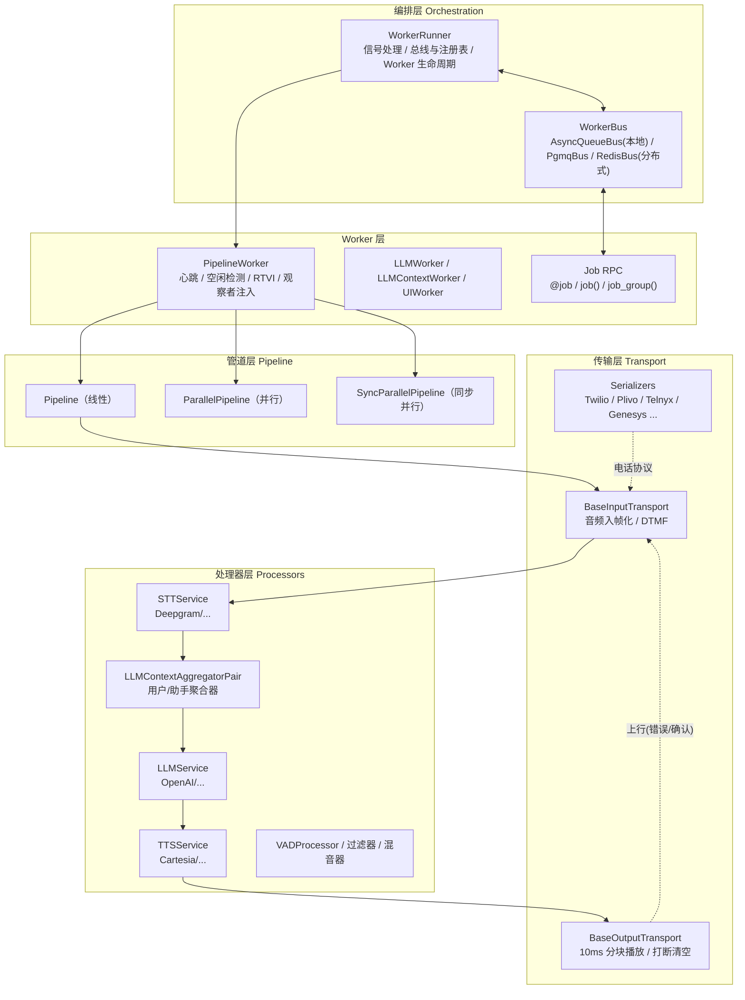
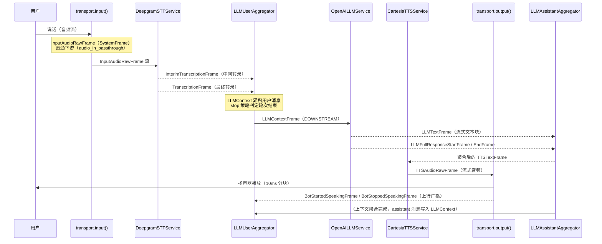
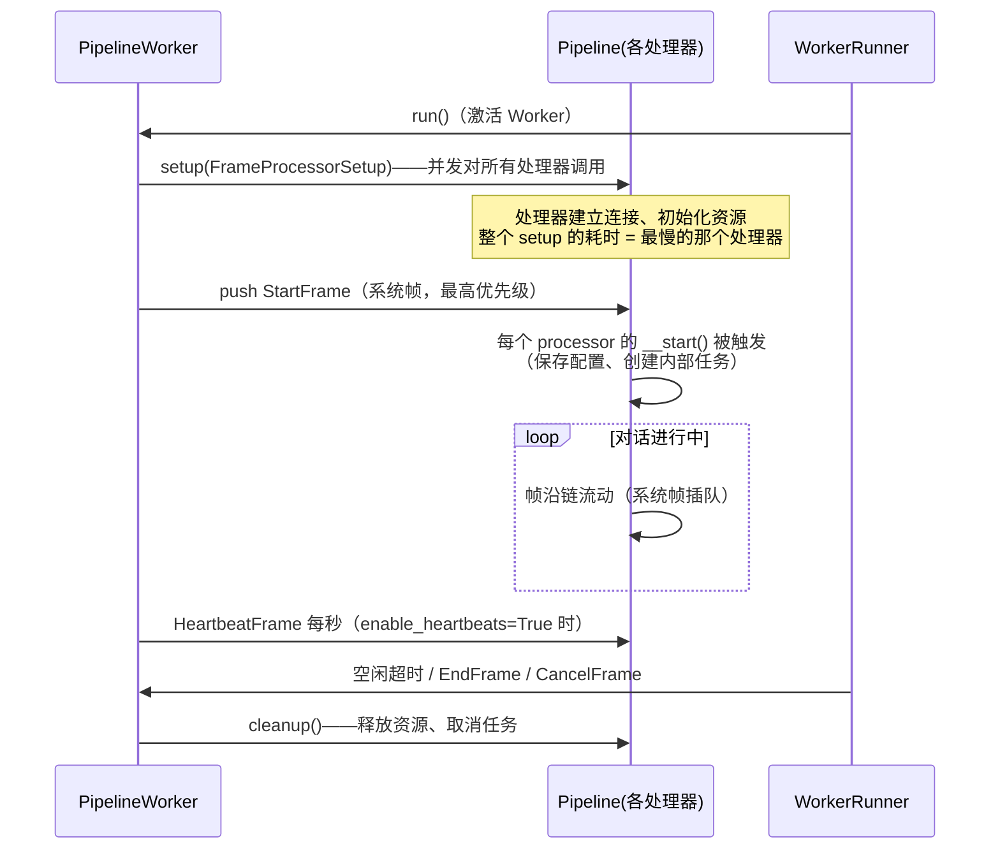

# 02 · 核心架构：帧流模型

[← 上一章：项目概览](01-project-overview.md) | [Wiki 首页](README.md) | [下一章：帧系统 →](03-frames.md)

> **本页要点**
>
> - Pipecat 的一切数据都是 **帧（Frame）**，一切计算都发生在 **帧处理器（FrameProcessor）** 中
> - 处理器按顺序链接成 **管道（Pipeline）**，管道由 **PipelineWorker** 驱动，Worker 由 **WorkerRunner** 编排
> - 帧有方向：**DOWNSTREAM**（输入→输出）承载音视频与文本数据，**UPSTREAM**（输出→输入）承载错误与确认
> - 一句话语音从麦克风到扬声器，要经过约 8 个处理器、跨越 20+ 种帧类型

## 2.1 心智模型：一条帧的流水线

理解 Pipecat 只需要一个模型：**工厂流水线**。

- **Frame（帧）**：流水线上传送的「工件」。一帧 20ms 的音频、一段文字、一条转录、一个控制信号，都是帧。
- **FrameProcessor（处理器）**：流水线上的「工位」。每个处理器从上游接收帧，加工后推给下游；也可以把帧推回上游。
- **Pipeline（管道）**：把工位按顺序串起来的「传送带」。
- **PipelineWorker（管道工人）**：驱动传送带运转的引擎——它推入第一帧（`StartFrame`），监控健康（心跳）、处理空闲与错误。
- **WorkerRunner（车间主任）**：管理多个工人，分配共享总线（Bus）与注册表（Registry），处理进程信号。

每个处理器内部有**两个异步队列**：输入优先队列（`FrameProcessorQueue`）和过程队列（`FrameQueue`）。系统帧（`SystemFrame`）在输入队列中获得最高优先级、由独立任务立即处理，这就是「打断」能瞬间生效而不被排队音频阻塞的原因（详见 [04 FrameProcessor](04-frame-processor.md)）。

## 2.2 分层架构总览



各层的职责边界非常清晰：

| 层 | 核心类 | 职责 | 源码位置 |
| ---- | ---- | ---- | ---- |
| 编排层 | `WorkerRunner`、`WorkerBus` | 生命周期、进程信号、跨 Worker 通信 | `src/pipecat/workers/runner.py`、`src/pipecat/bus/` |
| Worker 层 | `PipelineWorker`、`LLMWorker`、`UIWorker` | 单个 Agent 的运行时：心跳、空闲超时、错误策略 | `src/pipecat/pipeline/worker.py`、`src/pipecat/workers/` |
| 管道层 | `Pipeline`、`ParallelPipeline` | 处理器的编排与链接 | `src/pipecat/pipeline/` |
| 处理器层 | `FrameProcessor` 及所有服务 | 单一职责的帧加工 | `src/pipecat/processors/`、`src/pipecat/services/` |
| 传输层 | `BaseInputTransport` / `BaseOutputTransport` | 与外部世界的 I/O | `src/pipecat/transports/` |

## 2.3 一次语音对话的完整数据流

以 `examples/getting-started/06-voice-agent.py`（Deepgram STT + OpenAI LLM + Cartesia TTS + Silero VAD）为例，看用户说一句话后发生什么：



几个关键细节：

1. **`InputAudioRawFrame` 是 `SystemFrame`**（`src/pipecat/frames/frames.py:1896`），输入传输收到后立即处理，不会被排队的数据帧阻塞。
2. **用户聚合器是「轮次大脑」**：它消费转录帧但不转发（`llm_response_universal.py:928-943`），在 stop 策略判定轮次结束后才把整段用户消息写入 `LLMContext` 并推 `LLMContextFrame` 触发 LLM 推理。
3. **助手聚合器站在管道末尾**（`06-voice-agent.py:94`）：它消费 `TTSTextFrame` 把 bot 的话写回上下文，同时处理打断（把半截回复提交进 context，见 [07 轮次管理](07-turn-management.md)）。
4. **`LLMContextFrame` 的方向约定**：用户聚合器向 DOWNSTREAM 推（触发位于下游的 LLM 推理），助手聚合器在函数调用结果就绪时向 UPSTREAM 推——所以 LLM 服务通常放在聚合器对的下游（`llm_response_universal.py:2146-2345`）。

## 2.4 从示例代码看组装

一个完整语音 bot 的核心只有三段代码（节选自 `examples/getting-started/06-voice-agent.py`）：

```python
# 1. 实例化服务——每个服务就是一个 FrameProcessor
stt = DeepgramSTTService(api_key=os.environ["DEEPGRAM_API_KEY"])
tts = CartesiaTTSService(api_key=os.environ["CARTESIA_API_KEY"], settings=...)
llm = OpenAILLMService(api_key=os.environ["OPENAI_API_KEY"], settings=...)

# 2. 上下文 + 聚合器对——VAD 分析器挂在用户聚合器参数上
context = LLMContext()
user_aggregator, assistant_aggregator = LLMContextAggregatorPair(
    context,
    user_params=LLMUserAggregatorParams(vad_analyzer=SileroVADAnalyzer()),
)

# 3. 按数据流顺序串成管道
pipeline = Pipeline(
    [
        transport.input(),      # 用户输入（音频/视频入帧化）
        stt,                    # 语音 → 文本
        user_aggregator,        # 用户轮次管理与上下文写入
        llm,                    # 推理，流式输出文本
        tts,                    # 文本 → 语音
        transport.output(),     # 播放给用户
        assistant_aggregator,   # bot 轮次管理与上下文写入
    ]
)

worker = PipelineWorker(pipeline, params=PipelineParams(enable_metrics=True))
runner = WorkerRunner()
await runner.add_workers(worker)
await runner.run()
```

**读管道的口诀：从上往下是数据的主方向，最后一行往往不是「输出」而是「记账员」。** 用户聚合器管用户半边（转录进上下文、轮次起止、打断），助手聚合器管 bot 半边（bot 的话、函数调用结果进上下文）。

## 2.5 帧的方向性

帧沿两个方向流动（`src/pipecat/processors/frame_processor.py:59-68`）：

```python
class FrameDirection(Enum):
    """Direction of frame flow in the processing pipeline.

    Parameters:
        DOWNSTREAM: Frames flowing from input to output.
        UPSTREAM: Frames flowing back from output to input.
    """
    DOWNSTREAM = 1
    UPSTREAM = 2
```

| 方向 | 典型帧 | 语义 |
| ---- | ---- | ---- |
| DOWNSTREAM（输入→输出） | `InputAudioRawFrame`、`TranscriptionFrame`、`LLMTextFrame`、`TTSAudioRawFrame` | 对话数据向前流动 |
| UPSTREAM（输出→输入） | `ErrorFrame`、`BotStartedSpeakingFrame`、函数调用后的 `LLMContextFrame` | 错误上报、事件回传、触发重新推理 |

`push_frame(frame, FrameDirection.UPSTREAM)` 把帧交给 `_prev` 处理器，DOWNSTREAM 则交给 `_next`（`frame_processor.py:1212-1254`）。`broadcast_frame` 则双向各推一份（互设 `broadcast_sibling_id`），打断就是典型的双向广播。

**系统帧的优先级规则**：每个处理器的输入队列是三级优先队列（`frame_processor.py:149-151`）——`StartFrame` 优先级 1，其它 `SystemFrame` 优先级 10，普通帧 20；同级按到达顺序（单调递增计数器保证从不比较帧对象本身）。因此打断帧、转录帧这类系统帧总能「插队」通过每个处理器，而不会卡在一段没播完的音频后面。

## 2.6 处理器的生命周期

`PipelineWorker` 启动一条管道时的时序：



两个容易踩坑的点：

- **`StartFrame` 在 setup 完成前就推送**：每个处理器把 StartFrame 扣在手里直到自己的 setup 结束（`frame_processor.py` 的 `__setup_done` 事件机制），所以排在慢处理器前面的处理器可以先启动，但整体仍受 `setup_timeout_secs`（默认 20s）约束。
- **`EndFrame` 必须不可打断**：`EndFrame.interruptible = False`（`frames.py:2448`），否则用户一句打断就可能把「优雅退出」的帧从队列里丢掉，管道无法正常关闭。这就是「不可中断帧」设计的原因（详见 [03 帧系统](03-frames.md)）。

## 2.7 常用术语对照表

| 术语 | 英文 | 一句话定义 |
| ---- | ---- | ---- |
| 帧 | Frame | 流经管道的数据单元；有 id、名称、方向、可中断标志 |
| 处理器 | FrameProcessor | 接收、加工、推送帧的最小计算单元 |
| 管道 | Pipeline | 处理器线性链（或并行组合），本身也是 FrameProcessor |
| 管道工人 | PipelineWorker | 驱动一条管道的运行时：生命周期、监控、错误策略 |
| 车间主任 | WorkerRunner | 管理所有 Worker 与共享总线，处理 SIGINT/SIGTERM |
| 轮次 | User Turn | 用户一次完整的发言；由 start/stop 策略界定 |
| 打断 | Interruption | 用户打断 bot 说话；`InterruptionFrame` 双向广播清空可中断帧 |
| 聚合器 | Aggregator | 把流式片段聚合成整轮文本并写入 LLM 上下文的处理器 |
| 观察者 | Observer | 旁路监控帧流动、不修改管道的钩子 |
| 传输 | Transport | 一对 input/output 处理器，负责与外部世界 I/O |
| 服务 | Service | AI 供应商集成（STT/TTS/LLM…），继承自对应基类 |
| 序列化器 | Serializer | 帧与 WebSocket 线上格式的双向转换（含电话协议） |

## 2.8 小结

- **一个模型**：帧 + 处理器 + 管道；**两层运行时**：PipelineWorker（单 Agent）、WorkerRunner（多 Agent）。
- **三条铁律**：数据向下流、错误向上报、系统帧插队。
- **一对聚合器**是语音对话的中枢：用户聚合器决定「何时把用户的话交给 LLM」，助手聚合器决定「bot 说什么、何时记入上下文」。
- 理解了本页的骨架，后面章节都是往这副骨架上添肉：[03 帧系统](03-frames.md) 讲「工件」的种类，[04 FrameProcessor](04-frame-processor.md) 讲「工位」的内部构造。

[← 上一章：项目概览](01-project-overview.md) | [Wiki 首页](README.md) | [下一章：帧系统 →](03-frames.md)
