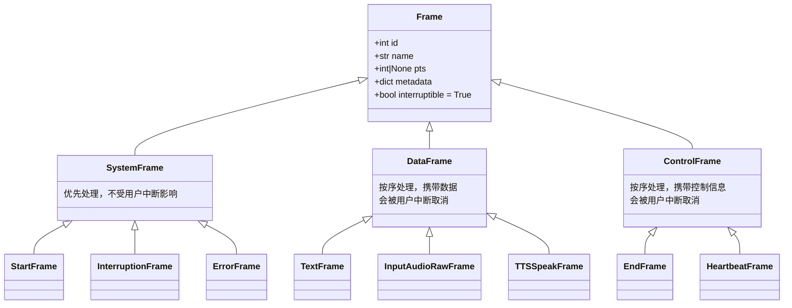
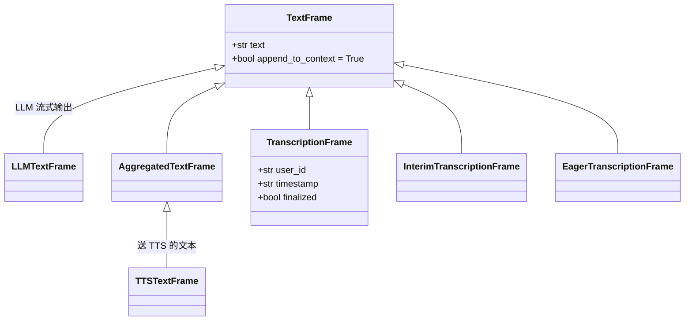
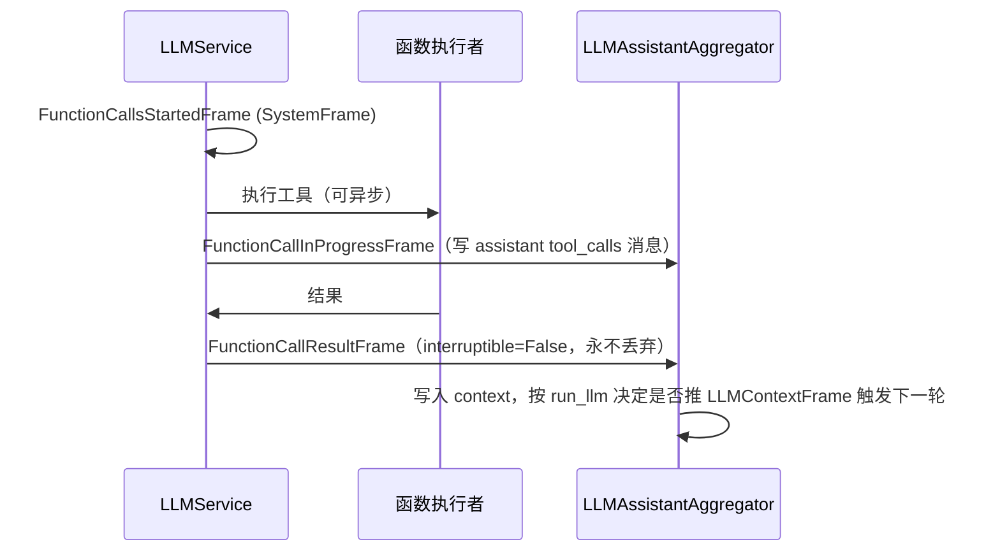

# 03 · 帧系统：100+ 种帧的完整地图

[← 上一章：核心架构](02-core-architecture.md) | [Wiki 首页](README.md) | [下一章：FrameProcessor →](04-frame-processor.md)

> **本页要点**
>
> - `Frame` 是 dataclass，全部字段由 `__post_init__` 初始化：唯一 `id`、类名计数 `name`、呈现时间戳 `pts`、`interruptible` 标志等
> - 三大直属子类：`SystemFrame`（系统帧，优先处理）、`DataFrame`（数据帧）、`ControlFrame`（控制帧）
> - **`interruptible` 标志**决定打断时帧是否被丢弃：默认 `True`（可被丢弃），类可声明 `interruptible=False` 自保
> - `UninterruptibleFrame` mixin 自 1.11.0 起废弃，统一改用 `interruptible: bool = field(default=False, init=False)` 声明
> - 错误帧会自动做凭据脱敏（`redact_secrets()`）

所有帧定义集中在 `src/pipecat/frames/frames.py`（约 3000 行，100+ 个类）。

## 3.1 Frame 基类解剖

```python
# src/pipecat/frames/frames.py:75-120（节选）
@dataclass
class Frame:
    # Base frame class for all frames.

    # All frames have:
    #   - a unique id
    #   - a name (e.g. "TextFrame#1")
    #   - a pts (presentation timestamp)
    #   ...

    def __post_init__(self):
        self.id: int = obj_id()
        self.name: str = f"{self.__class__.__name__}#{obj_count(self)}"
        self.pts: int | None = None
        self.broadcast_sibling_id: int | None = None
        self.metadata: dict[str, Any] = {}
        self.transport_source: str | None = None
        self.transport_destination: str | None = None
        if isinstance(self, UninterruptibleFrame):
            self.interruptible = False
```

| 字段 | 默认值 | 说明 | 行号 |
| ---- | ---- | ---- | ---- |
| `id` | `obj_id()` 全局自增 | 进程内唯一 id | `frames.py:109` |
| `name` | `f"{类名}#{按类计数}"` | 调试日志中的显示名，如 `TextFrame#42` | `frames.py:110` |
| `pts` | `None` | 呈现时间戳（纳秒），输出传输用它对齐音频/视频播放 | `frames.py:111` |
| `broadcast_sibling_id` | `None` | 双向广播帧的配对兄弟 id，用于关联上下游两份拷贝 | `frames.py:112` |
| `metadata` | `{}` | 自由元数据字典 | `frames.py:113` |
| `transport_source` / `transport_destination` | `None` | 帧来自/发往哪个传输目的地（如电话目的地、命名音频输出） | `frames.py:114-115` |
| `interruptible` | `True`（`init=False`） | 打断时是否允许把该帧从队列丢弃/取消处理 | `frames.py:106` |

注意 `id` 与 `name` 的区别：`id` 全局唯一，`name` 只是「类名 + 类内序号」，同一个进程里 `TextFrame#1` 会在每类帧出现——这正适合人读日志。

### 3.1.1 三大直属子类



| 子类 | 行号 | 语义 | 典型代表 |
| ---- | ---- | ---- | ---- |
| `SystemFrame` | `frames.py:123` | **优先处理**、由独立任务立即执行、不受用户打断影响 | `StartFrame`、`InterruptionFrame`、`ErrorFrame`、所有转录帧、`InputAudioRawFrame` |
| `DataFrame` | `frames.py:134` | 按序处理，携带文本/音频/图像等数据，**会被打断取消** | `TextFrame`、`TTSAudioRawFrame`、`TTSSpeakFrame` |
| `ControlFrame` | `frames.py:146` | 按序处理，携带控制信息（更新设置、结束管道等），**会被打断取消**——除非自行声明 `interruptible=False` | `EndFrame`、`StopFrame`、`HeartbeatFrame`、`ServiceUpdateSettingsFrame` |

优先级数字（见 [04 FrameProcessor](04-frame-processor.md) 的 `FrameProcessorQueue`）：`StartFrame`=1，`SystemFrame`=10，其余=20。**`ControlFrame` 没有优先级**——这也是 `EndFrame` 必须声明 `interruptible=False` 的原因：它排队，但排队期间不能被打断清掉。

### 3.1.2 `interruptible`：打断语义的核心开关

每个帧默认可被中断丢弃（`interruptible=True`）。三种改变方式：

```python
# 方式一：类级别声明（推荐）——EndFrame 就是这样自保的
@dataclass
class EndFrame(ControlFrame):
    interruptible: bool = field(default=False, init=False)   # frames.py:2448

# 方式二：实例级别（对单个帧生效）
frame = TTSSpeakFrame("这句话很重要，请听完")
frame.interruptible = False
await worker.queue_frames([frame])

# 方式三（已废弃）：UninterruptibleFrame mixin
# .. deprecated:: 1.11.0  Use the `interruptible` field with `default=False` instead.
```

**何时用方式二**：`TTSSpeakFrame` 的 docstring（`frames.py:1056-1057`）明说——「Set `interruptible=False` on the frame to preserve its synthesis and generated audio and text through interruptions」。典型场景是电话机器人报转账确认码：把 `TTSSpeakFrame` 和它前面的转移控制帧都设为不可打断，用户抢话也丢不掉（AGENTS.md 中的「transfer 场景」规则）。

内置的 `interruptible=False` 帧还有：`FunctionCallResultFrame`（「一旦生成结果总要保持 context 更新」，`frames.py:1038`）、`BotBackchannelFrame`（"Mm-hmm" 类短应答，`frames.py:1105`）等。

## 3.2 帧类型全景图

### 3.2.1 音频与媒体帧

| 帧类 | 行号 | 方向 | 说明 |
| ---- | ---- | ---- | ---- |
| `InputAudioRawFrame` | `frames.py:1896` | ↓ | **SystemFrame**。来自麦克风/网络的原始音频，直通 STT |
| `UserAudioRawFrame` | `frames.py:1954` | ↓ | 按用户分离的音频（Daily/LiveKit `audio_in_user_tracks=True` 时） |
| `OutputAudioRawFrame` | `frames.py:247` | ↓ | 输出音频（多继承 `DataFrame` + `AudioRawFrame` mixin） |
| `TTSAudioRawFrame` | `frames.py:287` | ↓ | TTS 合成的音频（携带 `context_id` 关联同一轮 TTS 请求） |
| `SpeechOutputAudioRawFrame` | `frames.py:300` | ↓ | 需要按说话节拍播放的输出音频 |
| `InputImageRawFrame` / `OutputImageRawFrame` | `frames.py:1914` / `:265` | ↓ | 视频帧 / 待显示图像（后者有 `sync_with_audio` 音画同步标志） |
| `UserImageRawFrame` | `frames.py:1971` | ↓ | 捕获的用户图像（送视觉模型 / 写入上下文） |
| `UserImageRequestFrame` | `frames.py:1867` | ↓ | SystemFrame。请求捕获一帧用户视频 |
| `FileRawFrame` / `InputFileRawFrame` / `UserFileRawFrame` | `frames.py:225` / `:1928` / `:1998` | ↓ | 文件传输 |
| `SpriteFrame` | `frames.py:330` | ↓ | 精灵图（多帧图像集合，角色口型动画用） |

### 3.2.2 文本与转录帧



| 帧类 | 行号 | 关键点 |
| ---- | ---- | ---- |
| `TextFrame` | `frames.py:349` | 通用文本。`append_to_context=True`（默认）表示助手聚合器会把它记入上下文 |
| `LLMTextFrame` | `frames.py:389` | LLM 流式输出的原始文本块 |
| `TTSTextFrame` | `frames.py:520` | **聚合后**准备送 TTS 的文本（AggregatedTextFrame 子类） |
| `TranscriptionFrame` | `frames.py:598` | 最终转录。字段：`user_id`、`timestamp`、`language`、`result`（STT 原始结果）、`finalized`（支持 commit 信号的 STT 设置）、`perception`（expressive alpha） |
| `InterimTranscriptionFrame` | `frames.py:628` | 中间转录（部分结果），无 `finalized` 字段 |
| `EagerTranscriptionFrame` | `frames.py:655` | STT **预测**轮次已结束但尚未提交的转录；可能被 `UserTurnResponseCancelFrame` 撤回，确认前不得进入上下文 |
| `TranslationFrame` | `frames.py:686` | 翻译结果 |
| `UserBackchannelFrame` | `frames.py:707` | 用户的短应答（"uh-huh"），不入上下文 |
| `BotBackchannelFrame` | `frames.py:1091` | bot 的短应答，继承 `TTSSpeakFrame` 但 `append_to_context=False`、`interruptible=False` |

### 3.2.3 LLM 控制与上下文帧

| 帧类 | 行号 | 说明 |
| ---- | ---- | ---- |
| `LLMContextFrame` | `frames.py:793` | 携带完整 `LLMContext` 的推理请求帧；`speculation: bool` 标记投机推理 |
| `LLMRunFrame` | `frames.py:881` | 「用当前上下文触发一次 LLM 推理」。客户端连接后最常见的开场方式 |
| `LLMMessagesAppendFrame` | `frames.py:892` | 追加消息，`run_llm: bool | None` 控制是否顺便触发推理 |
| `LLMMessagesUpdateFrame` / `LLMMessagesTransformFrame` | `frames.py:908` / `:924` | 整体替换 / 函数式变换上下文 |
| `LLMSetToolsFrame` / `LLMSetToolChoiceFrame` | `frames.py:941` / `:958` | 运行中更新工具集与工具选择 |
| `LLMEnablePromptCachingFrame` / `LLMConfigureOutputFrame` | `frames.py:969` / `:980` | 提示词缓存 / 结构化输出配置 |
| `LLMFullResponseStartFrame` / `LLMFullResponseEndFrame` | `frames.py:2612` / `:2630` | ControlFrame。LLM 一次完整响应的起止边界 |
| `LLMMarkerFrame` | `frames.py:399` | LLM 边带标记（如轮次完成协议的 ●/◐/○），应持久化进 context 但不走 TTS |
| `LLMMarkerResponseFrame` | `frames.py:433` | 响应结束时推的诊断帧（marker 与 raw text），供评估用 |
| `LLMThoughtStartFrame` / `LLMThoughtTextFrame` / `LLMThoughtEndFrame` | `frames.py:812` / `:840` / `:864` | 推理模型思维链（thinking）内容 |

### 3.2.4 函数调用帧族



外部函数调用（结果要等客户端/外部系统返回）有对应的一族：`ExternalFunctionCallsStartedFrame`（`frames.py:1732`）、`ExternalFunctionCallInProgressFrame`（`:1751`）、`ExternalFunctionCallResultFrame`（`:1771`，`is_final` 可分片返回）、`ExternalFunctionCallCancelFrame`（`:1794`）。

### 3.2.5 轮次与打断帧族

| 帧类 | 行号 | 说明 |
| ---- | ---- | ---- |
| `UserStartedSpeakingFrame` / `UserStoppedSpeakingFrame` | `frames.py:1437` / `:1448` | SystemFrame。轮次正式开始/结束（可能被轮次策略门控或延迟） |
| `VADUserStartedSpeakingFrame` / `VADUserStoppedSpeakingFrame` | `frames.py:1570` / `:1585` | VAD 的原始语音检测信号（未经轮次策略确认） |
| `ProposedUserStartedSpeakingFrame` / `ProposedUserStoppedSpeakingFrame` | `frames.py:1600` / `:1619` | STT/外部组件提出的「轮次起止提议」，由对应策略采纳或忽略 |
| `UserSpeakingFrame` | `frames.py:1518` | VAD 级「用户正在说话」（仅 VAD、无转录的管道用它保活空闲检测） |
| `UserTurnCompletionFrame` | `frames.py:1546` | LLM 对轮次完整性的判断（`complete`/`short`/`long`） |
| `UserTurnResponseCancelFrame` / `EagerEndOfTurnCancelFrame` | `frames.py:1462` / `:1485` | 撤回投机响应（bot 还没出声、轮次仍开放）——与打断的区别见 [07](07-turn-management.md) |
| `UserMuteStartedFrame` / `UserMuteStoppedFrame` | `frames.py:1496` / `:1507` | 静音状态翻转广播 |
| `InterruptionFrame` | `frames.py:1425` | SystemFrame。打断广播：清空可中断帧、取消进行中的处理 |
| `BotStartedSpeakingFrame` / `BotStoppedSpeakingFrame` | `frames.py:1636` / `:1647` | bot 开始/结束说话（输出传输双向广播） |
| `BotSpeakingFrame` | `frames.py:1658` | bot 说话中（每 0.2s 一次，喂给空闲检测与 RTVI） |

### 3.2.6 系统控制帧

| 帧类 | 行号 | 说明 |
| ---- | ---- | ---- |
| `StartFrame` | `frames.py:1204` | 管道的第一个帧，携带全部运行配置。**其字段自 1.8.0 起弃用读取**——应改读 `FrameProcessorSetup`（读取时发弃用警告） |
| `EndFrame` | `frames.py:2431` | 结束管道并关闭所有处理器；`interruptible=False` |
| `StopFrame` | `frames.py:2456` | 停止处理但保持处理器运行；`interruptible=False` |
| `CancelFrame` | `frames.py:1279` | 立即取消：不处理剩余排队帧。之后处理器不再接受任何帧（`_cancelling=True`） |
| `ErrorFrame` / `FatalErrorFrame` | `frames.py:1295` / `:1363` | 错误上报（上行）；`FatalErrorFrame` 与 `ErrorFrame.fatal` 字段均自 1.8.0 弃用，替代方案是 `push_error(..., force_treat_as_permanent=True)` 或 `ProcessorUnusablePolicy.CANCEL` |
| `HeartbeatFrame` | `frames.py:2559` | 每秒一次的心跳（ControlFrame），监控管道健康 |
| `MetricsFrame` | `frames.py:1671` | 指标聚合帧（SystemFrame），携带 TTFB/处理耗时/用量数据 |
| `PipelineFlushFrame` | `frames.py:2473` | flush 探针：等队列排空（多 Worker 等待对齐时使用） |
| `FrameProcessorPauseFrame` / `ResumeFrame`（含 Urgent 变体） | `frames.py:2574` / `:2590` 等 | 暂停/恢复指定处理器的帧处理 |
| `ServiceUpdateSettingsFrame[TSettings]` | `frames.py:2817` | 泛型：运行中更新服务设置；派生 `LLMUpdateSettingsFrame`/`TTSUpdateSettingsFrame`/`STTUpdateSettingsFrame` |

### 3.2.7 Worker 帧（跨 Worker 场景）

`WorkerFrame`（`frames.py:2234`）及其子类 `EndWorkerFrame`（`:2265`）、`StopWorkerFrame`（`:2286`）、`CancelWorkerFrame`（`:2299`）、`InterruptionWorkerFrame`（`:2317`）用于把「结束/取消/打断」的作用域从单条管道提升到 Worker 级别——在多 Worker 部署中，`BusEndWorkerMessage` 之类的总线消息会被转换成这些帧送达目标 Worker（详见 [10 多 Worker 协作](10-multi-worker.md)）。

## 3.3 ErrorFrame 的细节

`ErrorFrame` 是少数做了「安全加固」的帧：

- **凭据脱敏**：`__post_init__` 对 `error` 字符串调用 `redact_secrets()`（`frames.py:1336-1337`），防止 API key 泄漏到日志/客户端。
- **错误分类**：`category: ErrorCategory | None`（凭据被拒、provider 不可达、请求格式错误等）。`None` 表示待从 exception 推导，`ErrorCategory.UNKNOWN` 表示无法归类；帧到达终点前一定会被设置。
- **不可永久化**：自 1.8.0 起 `fatal` 字段弃用——「错误是否致命」不再是帧的属性，而是 `PipelineWorker.processor_unusable_policy` 的策略决定（见 [05](05-pipeline-and-worker.md)）。

## 3.4 自定义帧的写法

```python
from dataclasses import dataclass, field
from pipecat.frames.frames import DataFrame

@dataclass
class MyRetrievalResultFrame(DataFrame):
    """RAG 检索结果帧。

    Parameters:
        documents: 检索到的文档片段。
    """
    documents: list[str]

# 若希望它在用户打断时也不被丢弃：
@dataclass
class MyCriticalControlFrame(DataFrame):
    interruptible: bool = field(default=False, init=False)
    payload: dict
```

**惯例**：数据帧用 `@dataclass`（高频创建、无需校验）；携带外部 API 数据的配置对象才用 Pydantic（见 AGENTS.md 的 Dataclass vs Pydantic 约定）。

## 3.5 常用帧速查（按用途）

| 我想…… | 用什么帧 |
| ---- | ---- |
| 开启对话 / 触发一轮推理 | `LLMRunFrame`（或 `LLMMessagesAppendFrame(run_llm=True)`） |
| 让 TTS 直接念一句话 | `TTSSpeakFrame`（需要不被打断就设 `interruptible=False`） |
| 给 LLM 加一条消息而不推理 | `LLMMessagesAppendFrame(run_llm=False)` |
| 运行中换模型/声音/语言 | `LLMUpdateSettingsFrame` / `TTSUpdateSettingsFrame` / `STTUpdateSettingsFrame` |
| 捕获用户一帧图像 | `UserImageRequestFrame` |
| 发送 DTMF 按键 | `OutputDTMFFrame`（紧急用 `OutputDTMFUrgentFrame`） |
| 结束整条管道 | `EndFrame`（优雅）或 `CancelFrame`（立即） |
| 上报错误 | `await self.push_error(msg, exception, fatal=False)` |
| 给服务传自定义指令 | `OutputTransportMessageFrame` / 自定义 `DataFrame` |

## 3.6 小结

- 帧是唯一的数据语言：**类决定行为**（SystemFrame 插队、interruptible 决定生死），实例决定数据。
- 记住三条继承线：`SystemFrame`（不被打断影响）、`DataFrame`（会被打断取消）、`ControlFrame`（会排队、可通过 `interruptible=False` 自保）。
- 打断语义完全由 `interruptible` 标志驱动——「重要的话说完」不需要新机制，把帧标记为不可打断即可。
- 下一章进入处理器内部：队列、任务、事件与错误处理是如何实现的。

[← 上一章：核心架构](02-core-architecture.md) | [Wiki 首页](README.md) | [下一章：FrameProcessor →](04-frame-processor.md)
