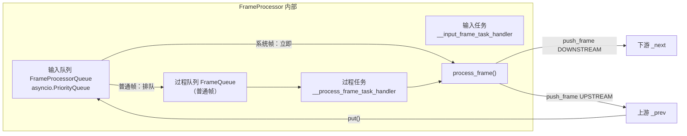
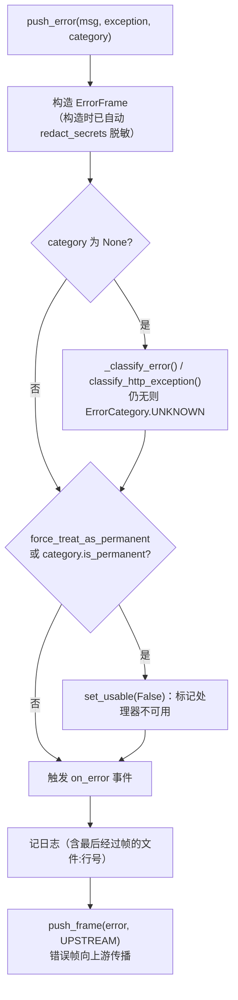

# 04 · FrameProcessor：一切处理器的基类

[← 上一章：帧系统](03-frames.md) | [Wiki 首页](README.md) | [下一章：Pipeline 与 PipelineWorker →](05-pipeline-and-worker.md)

> **本页要点**
>
> - 每个处理器内部有**两个队列、两个任务**：输入优先队列（系统帧插队）+ 过程队列（按序处理）
> - `process_frame()` 的契约：处理完必须显式 `await self.push_frame(frame, direction)` 转发——基类默认实现**不会**替你转发
> - 慢操作必须放进 `self.create_task()` 创建的后台任务，绝不阻塞 `process_frame`
> - `push_error()` 是错误上报的唯一正道：自动脱敏、分类、触发事件、上行推送
> - `broadcast_interruption()` 双向广播打断；`interruptible=False` 的帧在打断中幸存

源码：`src/pipecat/processors/frame_processor.py`（约 1400 行）。`FrameProcessor` 继承自 `BaseObject`（`src/pipecat/utils/base_object.py`），因此自带事件系统与任务管理。

## 4.1 内部结构：双队列 + 双任务



输入队列是三级优先队列（`frame_processor.py:149-151`）：

```python
START_PRIORITY = 1      # StartFrame
SYSTEM_PRIORITY = 10    # 其它 SystemFrame
DEFAULT_PRIORITY = 20   # 一切普通帧
```

- 同优先级用单调递增计数器保持到达顺序，**从不比较帧对象本身**（避免 dataclass 比较异常）。
- 系统帧由输入任务**立即处理**（`frame_processor.py:1352-1378`）；普通帧转入过程队列，由过程任务按序处理（`:1380-1398`）。
- 这就是打断能瞬间生效的机制基础：`InterruptionFrame` 是 SystemFrame，无论前面压了多少音频帧都能立刻被处理。

关键内部状态：`_prev`/`_next`（双向链表指针）、`_cancelling`（收到 `CancelFrame` 后为 True，静默丢弃一切后续帧，`:261`）、`__process_current_frame`（当前正在处理的帧，中断判断的依据）。

## 4.2 生命周期与身份

```python
# frame_processor.py:230-246
def __init__(
    self,
    *,
    name: str | None = None,
    enable_direct_mode: bool = False,
    metrics: FrameProcessorMetrics | None = None,
    **kwargs,
):
```

- `name`：未提供时自动生成 `f"{类名}#{按类计数}"`（如 `OpenAILLMService#1`）。日志、暂停/恢复帧匹配（按 `frame.processor.name`）都靠它。
- `enable_direct_mode`：跳过内部队列立即处理帧（`:743-747`）。`Pipeline` 自身就是 direct mode（`pipeline.py:107` `super().__init__(enable_direct_mode=True)`）——管道作为复合处理器直接处理帧，内部链路不重复排队。
- 身份属性：`id`（obj_id 全局唯一）、`name`；访问相邻处理器用 `previous` / `next` property（`:397-413`）。

### 4.2.1 setup / cleanup

```python
# frame_processor.py:650-668
async def setup(self, setup: FrameProcessorSetup):
    """Set up the frame processor.

    Args:
        setup: The frame processor setup.
    """
```

`FrameProcessorSetup`（`:74-137`）携带全部运行配置：

| 字段 | 说明 |
| ---- | ---- |
| `clock` / `task_manager` | 时钟与任务管理器（由 Worker 注入） |
| `pipeline_worker` | 所属的 PipelineWorker（`self.pipeline_worker` 属性的来源） |
| `audio_in_sample_rate` / `audio_out_sample_rate` | 采样率（16000 / 24000 默认） |
| `enable_metrics` / `enable_usage_metrics` / `enable_tracing` | 开关 |
| `enable_expressive_conversation` / `expression_policy` | 表情对话（alpha） |
| `observer` | 每次处理帧的观察者（`on_process_frame` 回调） |

生命周期规则：

- `setup()` 由管道**并发**调用所有处理器，整体耗时等于最慢者（如一个慢连接的 STT）；`setup_timeout_secs`（默认 20s）超时则整个 Worker 被拆除（`pipeline/worker.py`）。跨处理器共享资源需用 `pipecat.utils.shared.acquires` 保护。
- `cleanup()`（`:681-695`）取消内部 input/process 任务并清理 metrics；经 `create_task` 创建的任务由子类在覆写中自行释放。
- `StartFrame` 扣留机制：setup 开始时 `__setup_done` 事件被清空，每个处理器把 StartFrame 扣到自己 setup 完成才放行——排在前面的处理器不必等后面慢的，但 StartFrame 永远不会先于任何处理器的 setup 被处理。

## 4.3 process_frame 契约

```python
# frame_processor.py:849-876（默认实现节选）
async def process_frame(self, frame: Frame, direction: FrameDirection):
    observer = self._setup.observer if self._setup else None
    if observer:
        data = FrameProcessed(processor=self, frame=frame, direction=direction, ...)
        await observer.on_process_frame(data)

    if isinstance(frame, StartFrame):
        await self.__start(frame)
    elif isinstance(frame, InterruptionFrame):
        await self._start_interruption()
        await self.stop_all_metrics()
    elif isinstance(frame, CancelFrame):
        await self.__cancel(frame)
    elif isinstance(frame, (FrameProcessorPauseFrame, FrameProcessorPauseUrgentFrame)):
        await self.__pause(frame)
    elif isinstance(frame, (FrameProcessorResumeFrame, FrameProcessorResumeUrgentFrame)):
        await self.__resume(frame)
```

**契约三句话**：

1. 基类默认实现只做内建帧处理 + 观察者通知，**不转发任何帧**。
2. 子类重写 `process_frame()` 处理自己关心的帧，其余帧必须显式转发：`await self.push_frame(frame, direction)`。
3. 想要 StartFrame/打断/取消的内建处理，就 `await super().process_frame(frame, direction)`——Pipecat 全部服务子类都这么做。

标准写法骨架：

```python
class MyFilter(FrameProcessor):
    def __init__(self, **kwargs):
        super().__init__(**kwargs)
        self._task: asyncio.Task | None = None

    async def process_frame(self, frame: Frame, direction: FrameDirection):
        await super().process_frame(frame, direction)      # 内建行为

        if isinstance(frame, MyRetrievalResultFrame):
            await self.push_frame(frame, direction)         # 数据继续走
            self._task = self.create_task(self._lookup(frame))  # 慢活交给任务
        elif isinstance(frame, StartFrame):
            # 初始化
        else:
            await self.push_frame(frame, direction)         # 其它一律转发

    async def _lookup(self, frame: MyRetrievalResultFrame):
        result = await some_slow_api()                       # 后台执行
        await self.push_frame(TransformedFrame(result))
```

## 4.4 帧的进出：queue_frame 与 push_frame

- **`queue_frame(frame, direction, callback)`**（`:726-757`）：帧进入本处理器的入口。`_cancelling` 时静默丢弃；direct mode 立即处理；否则入输入优先队列。上游处理器调用的是你的 `queue_frame`。
- **`push_frame(frame, direction)`**（`:1035-1046`）：帧离开本处理器的出口。前后各触发 `on_before_push_frame` / `on_after_push_frame` 事件，核心 `__internal_push_frame`（`:1212-1254`）按方向交给 `_next.queue_frame()` 或 `_prev.queue_frame()`，并通知 `FramePushed` 观察者。
- **`broadcast_frame(SomeFrame)`**：创建两个实例分别向上下游推送，互设 `broadcast_sibling_id`。
- 注意：`queue_frames()` 不存在于 `FrameProcessor`——它只在 `PipelineWorker` 上（`pipeline/worker.py:951`）。

## 4.5 慢工作与任务管理

AGENTS.md 的规则在本版源码中的体现：

> **Keep `process_frame` fast**：一个处理器一次只处理一帧，`process_frame` 里做什么，其它所有帧就得等什么，管道里它身后的所有处理器陪着一起等。系统帧能跳队列但**不能打断正在执行的调用**。

因此：

```python
# 正确：慢活丢给 TaskManager 管理的任务
self.create_task(self._transcribe(segment), name="transcribe")   # base_object.py:131-152
await self.cancel_task(task, timeout=1.0)                        # 默认 1 秒超时
```

- `create_task(coroutine, name)` 把任务交给 `BaseTaskManager`：任务名自动加 `{processor}::` 前缀；**绝不**直接用 `asyncio.create_task()`（Worker 结束时未跟踪的任务会泄漏并触发 dangling-task 告警）。
- `cancel_task(task, timeout=1.0)` 的默认超时是防「库吞掉 `asyncio.CancelledError`」造成冻结。
- 典型范例：`SegmentedSTTService` 把每段语音的转写放进后台任务——若在 `process_frame` 内联转写，下游 VAD 将拿不到音频帧，打断检测全面失灵（v1.15.0 的 changelog 正是这次清理）。

## 4.6 错误处理：push_error

```python
# frame_processor.py:893-901
async def push_error(
    self,
    error_msg: str,
    exception: Exception | None = None,
    fatal: bool = False,                      # 1.8.0 起弃用
    category: ErrorCategory | None = None,
    force_treat_as_permanent: bool = False,
):
```

`push_error_frame()`（`:987-1033`）的完整行为链：



要点：

- **服务应使用默认 `fatal=False`**，让应用代码有机会处理错误（例如切换供应商）——这是 AGENTS.md 明确的服务实现规范。
- `force_treat_as_permanent=True` 表示「错误会持续复发、处理器已无法工作」；PipelineWorker 会依据 `ProcessorUnusablePolicy` 决定继续/结束/取消（见 [05](05-pipeline-and-worker.md)）。
- `ErrorFrame.fatal` 与 `FatalErrorFrame` 均已废弃，「是否致命」从帧属性变成了 Worker 策略。

## 4.7 打断：broadcast_interruption

```python
# frame_processor.py:1048-1053
async def broadcast_interruption(self):
    """Broadcast an `InterruptionFrame` both upstream and downstream."""
    logger.debug(f"{self}: broadcasting interruption")
    self.__reset_process_task()
    await self.stop_all_metrics()
    await self.broadcast_frame(InterruptionFrame)
```

本处理器收到 `InterruptionFrame` 后，`_start_interruption()`（`:1161-1188`）根据**当前正在处理的帧**是否可中断决定行为：

```python
current_is_uninterruptible = current is not None and not current.interruptible
if current_is_uninterruptible:
    # 当前帧不可打断：只清空队列里可打断的帧，不可打断的保留待处理
    self.__reset_process_queue()
else:
    # 取消并重建过程任务
    await self.__cancel_process_task()
    self.__create_process_task()
```

任何处理器都可以主动发起打断——调用 `await self.broadcast_interruption()` 即可（旧的 `push_interruption_task_frame_and_wait()` 已废弃并委托给它）。谁最常调用它？用户轮次开始策略触发的用户聚合器（见 [07](07-turn-management.md)）。

## 4.8 事件系统（BaseObject）

`FrameProcessor` 继承 `BaseObject` 的事件机制（`base_object.py`）：

```python
# frame_processor.py:307-313——本类注册的事件
self._register_event_handler("on_before_process_frame", sync=True)
self._register_event_handler("on_after_process_frame", sync=True)
self._register_event_handler("on_before_push_frame", sync=True)
self._register_event_handler("on_after_push_frame", sync=True)
self._register_event_handler("on_error", sync=True)
self._register_event_handler("on_usable_changed")
```

用法：

```python
@processor.event_handler("on_error")
async def on_error(processor: FrameProcessor, error: ErrorFrame):
    ...
```

两种执行模式的语义：

- **`sync=True`**：在当前协程内直接 `await` 执行——立即但必须快（会阻塞帧处理）。
- **默认（后台）**：每个 handler 起一个 `asyncio.create_task`，慢处理不阻塞帧流。
- handler 签名统一为 `(processor, *args)`；handler 异常被捕获记日志、不外抛；`cleanup()` 会等待所有未完成的事件任务。

注意：`sync=True` 的处理器事件（如 `on_before_push_frame`）在帧处理的热路径上，handler 必须轻量。

## 4.9 pipeline_worker：处理器如何找到 Worker

```python
# frame_processor.py:453-464
@property
def pipeline_worker(self) -> PipelineWorker:
    """Get the PipelineWorker this processor is running in.

    Provides access to worker-scoped state from inside a processor — most
    notably ``self.pipeline_worker.app_resources`` for the application's
    shared bag of resources (DB handles, clients, feature flags, etc.).
    """
    return self.processor_setup.pipeline_worker
```

- **只在 setup 之后可用**，提前访问会抛异常。
- 函数调用处理器里也可用：`FunctionCallParams.pipeline_worker` 字段（`llm_service.py:171`）让工具函数直接拿 Worker（进而拿 `app_resources`）。
- 同族的 `worker_runner` property（`:466-476`）返回 `pipeline_worker.worker_runner`；旧的 `pipeline_task` 已废弃（1.3.0）。

## 4.10 暂停与恢复

高级 API（`:759-822`）：

| 方法 | 作用 |
| ---- | ---- |
| `pause_processing_frames()` / `resume_processing_frames()` | 暂停/恢复普通帧处理（系统帧照常） |
| `pause_processing_system_frames()` / `resume_processing_system_frames()` | 暂停/恢复系统帧（输入任务阻塞） |
| `pause_processing_all_frames_until(ready, timeout=5.0)` | 暂停到 `ready` 事件置位（如切换目的地时防止帧乱窜） |

## 4.11 最佳实践清单

| 规则 | 原因 |
| ---- | ---- |
| `process_frame` 只做判断与转发，慢活进 `create_task` | 处理器串行处理，阻塞即全线阻塞 |
| 一律 `await super().process_frame(frame, direction)` 开头 | 获得 StartFrame/打断/取消/暂停的内建处理 |
| 不认识的帧也要转发 | 丢帧 = 破坏下游（别忘了 else 分支） |
| 错误用 `push_error`，服务不要 `fatal=True` | 应用层应有机会 failover |
| 后台任务用 `self.create_task`，取消用 `await self.cancel_task` | TaskManager 统一跟踪，结束时自动清理 |
| 事件 handler（尤其 `sync=True`）保持轻量 | 热路径 |

## 4.12 小结

- 处理器 = **双队列 + 双任务 + process_frame 契约**；优先队列让系统帧穿过一切拥堵。
- **转发责任在子类**：基类不替你 `push_frame`，`super().process_frame()` 换来内建的打断/取消/暂停行为。
- 错误是一条上行的 `ErrorFrame` 流水线：脱敏 → 分类 → 标记不可用 → on_error 事件 → 上推。
- 打断的核心分支只有一行：当前帧是否 `interruptible`。

[← 上一章：帧系统](03-frames.md) | [Wiki 首页](README.md) | [下一章：Pipeline 与 PipelineWorker →](05-pipeline-and-worker.md)
