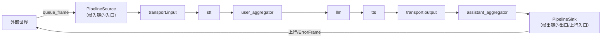
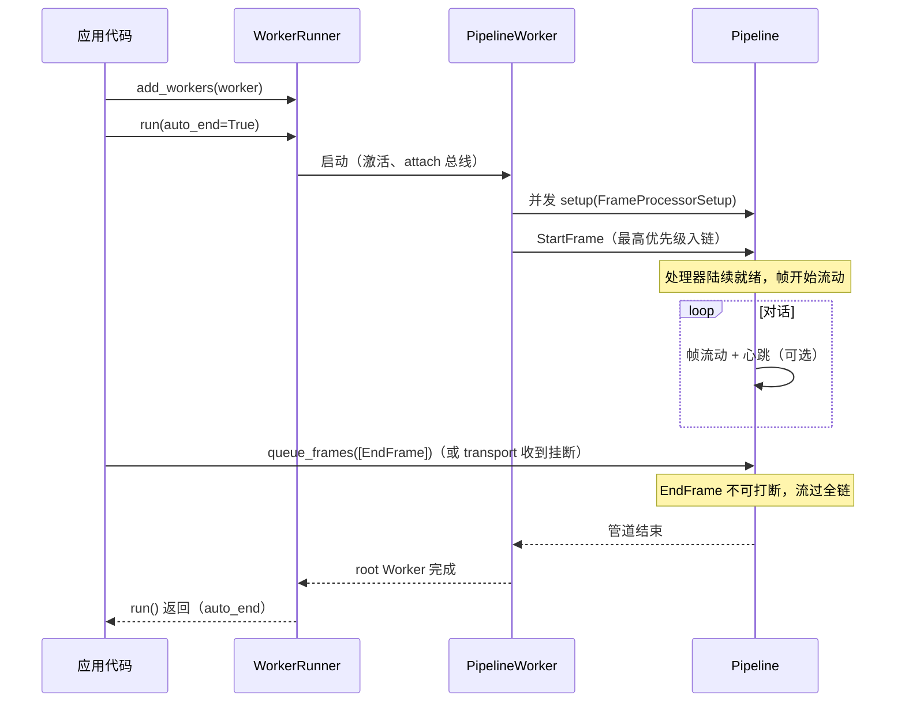

# 05 · Pipeline 与 PipelineWorker

[← 上一章：FrameProcessor](04-frame-processor.md) | [Wiki 首页](README.md) | [下一章：LLM 上下文与聚合器 →](06-llm-context-aggregation.md)

> **本页要点**
>
> - `Pipeline` 是处理器线性链，自动加 `PipelineSource`/`PipelineSink` 头尾，本身也是 `FrameProcessor`
> - **1.3.0 起 `PipelineWorker` 取代了 `PipelineTask`**：Worker 拥有完整生命周期（setup→start→运行→end/cancel）、心跳、空闲检测、错误策略
> - `PipelineParams` 控制采样率/指标/心跳，经 `StartFrame` 广播给所有处理器；Worker 自身的参数走构造函数
> - `WorkerRunner` 是最高层入口：注册 Worker、持有共享总线与注册表、处理 SIGINT/SIGTERM、`auto_end` 自动收尾

## 5.1 Pipeline：处理器的线性链

```python
# src/pipecat/pipeline/pipeline.py:91-124
class Pipeline(BasePipeline):
    """Main pipeline implementation that connects frame processors in sequence.

    Creates a linear chain of frame processors with automatic source and sink
    processors for external frame handling. ...
    """

    def __init__(
        self,
        processors: Sequence[FrameProcessor],
        *,
        source: FrameProcessor | None = None,
        sink: FrameProcessor | None = None,
    ):
        super().__init__(enable_direct_mode=True)

        # Add a source and a sink queue so we can forward frames upstream and
        # downstream outside of the pipeline.
        self._source = source or PipelineSource(self.push_frame, name=f"{self}::Source")
        self._sink = sink or PipelineSink(self.push_frame, name=f"{self}::Sink")
        self._processors: list[FrameProcessor] = [self._source, *processors, self._sink]

        self._link_processors()
```

结构解读：



- **`PipelineSource` / `PipelineSink`**（`pipeline.py:21` / `:55`）：自动添加的虚拟头尾。外部帧（如 `worker.queue_frames()` 推入的 `LLMRunFrame`）从 Source 进链；上行帧从 Sink 出链交给 Worker。它们让「链内链外」的帧流动有统一出入口。
- **`_link_processors()`**（`:200`）：逐个调用 `processor.link(next)` 建立双向链。
- **Pipeline 自身是 direct mode 的 FrameProcessor**（`enable_direct_mode=True`）：帧到达 Pipeline 时直接沿链传递，不在 Pipeline 层再排队。
- `processors` property（`:128`）返回包含 Source/Sink 的全部子处理器；`processors_with_metrics`（`:153`）收集需要指标统计的处理器。

### 5.1.1 并行变体

| 类 | 文件 | 用途 |
| ---- | ---- | ---- |
| `ParallelPipeline` | `pipeline/parallel_pipeline.py` | 多条子管道**并行**接收同一帧（如同时跑翻译和语音识别）；各分支独立流动 |
| `SyncParallelPipeline` | `pipeline/sync_parallel_pipeline.py` | 并行但**同步推进**的变体（帧在各分支间对齐步调） |
| `llm_switcher.py` / `service_switcher.py` | 同目录 | 运行中在多个 LLM/服务之间切换 |

## 5.2 PipelineWorker：管道的运行时

> **迁移提示**：`PipelineTask` 是 1.3.0 起的废弃别名（`pipeline/task.py`），构造 `PipelineWorker` 即可。

`PipelineWorker(BaseWorker)`（`pipeline/worker.py:211`）——「Manages the execution of a pipeline, handling frame processing and worker lifecycle」。它在管道外围包了错误处理、Worker 级事件、心跳监控等设施。

### 5.2.1 构造参数全表（`worker.py:286-360`）

| 参数 | 默认值 | 说明 |
| ---- | ---- | ---- |
| `pipeline` | （必填） | 要执行的 `BasePipeline` |
| `active` | `True` | Worker 启动时是否激活（转发给 BaseWorker） |
| `app_resources` | `None` | **应用自定义资源袋**（DB 连接、HTTP 客户端等），按引用传递：`worker.app_resources` 与 `FunctionCallParams.app_resources` 都能拿到；框架不拷贝不清空 |
| `bridged` | `None` | 总线桥接配置：`None` 不桥接；`()` 包一层 bus 边缘处理器接受所有桥；`("voice",)` 只接受指定名字的桥（总线来自 runner 的 `attach`） |
| `cancel_on_idle_timeout` | `True` | 空闲超时是否取消本 Worker；`False` 时仅触发 `on_idle_timeout` 事件 |
| `cancel_runner_on_idle_timeout` | `True` | 空闲超时是否连带取消整个 Runner（广播 `BusCancelMessage`）；旁挂 Worker 设 `False` 免得拖累同伴 |
| `cancel_timeout_secs` | `20.0` | 取消等待超时 |
| `capabilities` | `None` | 显式声明 bot 能力（`BotCapabilities`），覆盖从管道推导出的默认值 |
| `check_dangling_tasks` | `True` | 结束时告警未完成的遗留任务 |
| `clock` | `None` | 自定义时钟 |
| `conversation_id` | `None` | 自定义会话 ID |
| `enable_rtvi` | `None` | 是否自动加 RTVI 支持；默认**除非 bridged** 都加（桥接 Worker 没有自己的客户端） |
| `enable_tracing` | `False` | OpenTelemetry 追踪 |
| `enable_turn_tracking` | `True` | 轮次追踪（TurnTrackingObserver 自动注入） |
| `exclude_frames` | `None` | bridged 时不跨总线的额外帧类型（生命周期帧永远排除） |
| `idle_timeout_frames` | 5 种帧元组 | 视为「管道活跃」的帧类型 |
| `idle_timeout_secs` | `300.0` | 空闲超时秒数（`None` 禁用） |
| `name` | `None` | Worker 名（总线上按名寻址用） |
| `observers` | `None` | 观察者列表（详见 [12](12-observers-metrics.md)） |
| `processor_unusable_policy` | `CONTINUE` | 处理器不可用时怎么办 |
| `params` | `None` | `PipelineParams`（见下） |
| `rtvi_processor` / `rtvi_observer_params` | `None` | 自定义 RTVI 处理器 / 观察者参数 |
| `setup_timeout_secs` / `start_timeout_secs` | `20.0` / `20.0` | setup 与 StartFrame 送达的超时 |
| `task_manager` | `None` | 外部任务管理器（Runner 通常接管） |

默认 `idle_timeout_frames` 值得一看（`worker.py:302-308`）：`BotSpeakingFrame`、`InterimTranscriptionFrame`、`TranscriptionFrame`、`UserSpeakingFrame`、`UserStartedSpeakingFrame`——同时覆盖「VAD 驱动」与「供应商转录驱动」两种管道形态，任何一种活动都能续命空闲计时器。

### 5.2.2 PipelineParams：经 StartFrame 广播的管道配置

```python
# pipeline/worker.py:167-207（字段节选）
class PipelineParams(BaseModel):
    audio_in_sample_rate: int = 16000
    audio_out_sample_rate: int = 24000
    enable_expressive_conversation: bool = False
    expression_policy: ExpressionPolicy | None = None
    enable_heartbeats: bool = False
    enable_metrics: bool = False
    enable_usage_metrics: bool = False
    heartbeats_period_secs: float = 1.0
    heartbeats_monitor_secs: float = 10.0
    report_only_initial_ttfb: bool = False
    send_initial_empty_metrics: bool = True
    start_metadata: dict[str, Any] = Field(default_factory=dict)
```

**分工原则**（docstring 原话）：`PipelineParams` 里的参数经 `StartFrame` 传给**所有处理器**；Worker 级的其它参数用 `PipelineWorker` 构造函数。

### 5.2.3 ProcessorUnusablePolicy：错误如何终结管道

```python
# pipeline/worker.py:147-164
class ProcessorUnusablePolicy(Enum):
    """What a pipeline worker does when a processor can no longer do its job.

    An unusable processor keeps failing for as long as the pipeline keeps
    using it, so the pipeline has to decide whether it is still worth running.
    A processor becomes unusable through a permanent error category or through
    FrameProcessor.push_error with force_treat_as_permanent=True.

    Parameters:
        CONTINUE: Report the error and keep running. The application can decide
            what to do, for example by failing over to another provider.
        END: End the pipeline gracefully, letting queued frames drain first.
        CANCEL: Cancel the pipeline immediately, abandoning queued frames.
    """
    CONTINUE = "continue"
    END = "end"
    CANCEL = "cancel"
```

三个值的取舍：

- **CONTINUE**（默认）：错误上报给 `on_pipeline_error` 事件处理器，应用自己决定（failover 到备用 LLM 等）。
- **END**：优雅收尾——排队帧先处理完再结束（官方示例 `06-voice-agent.py` 用它：`processor_unusable_policy=ProcessorUnusablePolicy.END`）。
- **CANCEL**：立即取消、丢弃排队帧——等价于旧的 `fatal=True` 行为。

### 5.2.4 Worker 级公开方法

| 方法 | 说明 |
| ---- | ---- |
| `queue_frames(frames, direction=DOWNSTREAM)` | 外部向管道推帧（`worker.py:951`）；接受 `Iterable` 或 `AsyncIterable`。示例中的 `await worker.queue_frames([LLMRunFrame()])` |
| `flush_pipeline()` | 发 `PipelineFlushFrame` 探针并等待排空确认 |
| `event_handler(...)` | Worker 级事件：启动、结束、空闲超时、管道错误、各 Worker 帧到达（`on_idle_timeout`、`on_pipeline_error`、`on_client_connected` 相关事件在 transport 上注册） |
| `app_resources` | 共享资源袋 |

### 5.2.5 监控机制

- **心跳**（`enable_heartbeats=True`）：`HeartbeatFrame` 每 `heartbeats_period_secs`（1s）发一帧；`heartbeats_monitor_secs`（10s）收不到就告警。心跳帧是 ControlFrame，跟普通帧一起排队——**它能探出队列拥塞**，这是它比纯进程级心跳高明的地方。
- **空闲检测**：`IdleFrameObserver`（`worker.py:117-144`）监听帧推送，`idle_timeout_frames` 中的任何帧推送都会重置 `idle_event`；超时后按 `cancel_on_idle_timeout` / `cancel_runner_on_idle_timeout` 行动并触发 `on_idle_timeout` 事件。
- **两次启动超时**：setup 并发但限时（`setup_timeout_secs`）；StartFrame 从头流到尾也限时（`start_timeout_secs`）——卡死的处理器不会让管道「永远起不来」，而是拆除重来。

## 5.3 WorkerRunner：最高层编排

```python
# src/pipecat/workers/runner.py（docstring 节选）
# For a typical single-pipeline bot, register the worker with
# add_workers and then call run:
#     runner = WorkerRunner()
#     await runner.add_workers(worker)
#     await runner.run()
```

`WorkerRunner(BaseObject, BusSubscriber)`（`runner.py:83`）拥有整个会话的共享 `WorkerBus`、`WorkerRegistry` 与 worker 管理器。

| 方法 | 行号 | 说明 |
| ---- | ---- | ---- |
| `add_workers(*workers)` | `:197` | 注册 Worker（内部记录 `_WorkerEntry`） |
| `run(auto_end=True, ...)` | `:235` | 运行所有 Worker 直到完成；**`auto_end=True` 时所有 root Worker 结束即退出**——单管道 bot 天然随管道结束而结束 |
| `end(reason=None)` | `:329` | 优雅结束全部 Worker（`EndWorkerFrame`） |
| `cancel(reason=None)` | `:343` | 立即取消全部 Worker（`CancelWorkerFrame`）——示例里客户端断连时 `await runner.cancel()` |
| `get_worker(name)` | `:181` | 按名字取 Worker |
| `bus` / `registry` | `:172` / `:177` | 共享总线与注册表（多 Worker 场景见 [10](10-multi-worker.md)） |

**信号处理**：`handle_sigint=True`（默认）时注册 SIGINT/SIGTERM（`:538-563`），信号触发全量 cancel——Ctrl+C 一次即可干净退出。

**auto_end 的两种形态**：

1. 单管道 bot：`run()` 随管道结束自动退出（如一条 `EndFrame` 走完全链）。
2. 长驻宿主（FastAPI 服务器反复 add/remove Worker）：`run(auto_end=False)`，由事件处理器（如 transport 断连）显式调用 `end()`/`cancel()`。

## 5.4 完整时序：从 run() 到 EndFrame



## 5.5 小结

- **Pipeline 管链接，PipelineWorker 管生命**：前者是数据结构，后者是运行时引擎（心跳、空闲、错误策略、超时拆除）。
- **三层配置各归其位**：`PipelineParams`（经 StartFrame 广播给处理器）→ `PipelineWorker(...)` 构造参数（Worker 级行为）→ `WorkerRunner.run(auto_end=...)`（会话级收尾）。
- **错误不再有 fatal 帧**：`ProcessorUnusablePolicy` 把「失败怎么办」变成显式策略，`CONTINUE` 留给应用做 failover。
- `queue_frames` 是外部世界向管道注入帧的唯一入口（帧经 Source 进链）；`EndFrame`/`CancelFrame` 的不可打断声明保证收尾永远可达。

[← 上一章：FrameProcessor](04-frame-processor.md) | [Wiki 首页](README.md) | [下一章：LLM 上下文与聚合器 →](06-llm-context-aggregation.md)
