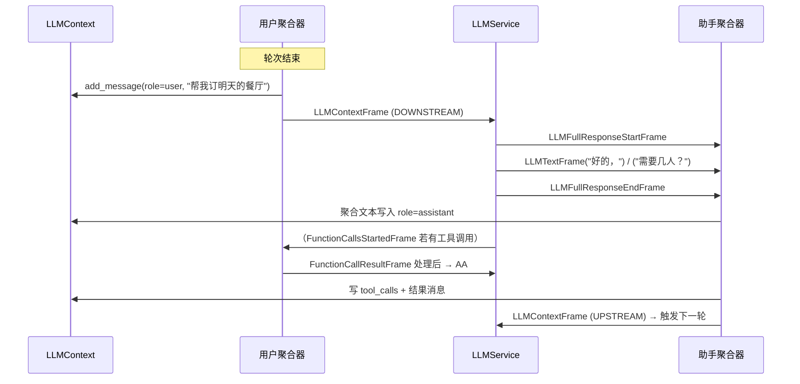

# 06 · LLM 上下文与聚合器

[← 上一章：Pipeline 与 PipelineWorker](05-pipeline-and-worker.md) | [Wiki 首页](README.md) | [下一章：轮次管理与打断 →](07-turn-management.md)

> **本页要点**
>
> - `LLMContext` 以「基于 OpenAI 的通用格式」存消息，LLM 服务通过 **adapter 即时翻译**成供应商格式
> - `LLMContextAggregatorPair` 产出两个聚合器：**用户侧**（转录→轮次→写入上下文→触发推理）与**助手侧**（bot 文本、函数调用→写入上下文）
> - `LLMRunFrame` / `LLMContextFrame` 是触发推理的帧；用户聚合器向 DOWNSTREAM 推，助手聚合器在函数结果就绪时向 UPSTREAM 推
> - 轮次完成 marker（●/◐/○）、上下文摘要、持久化上下文都构建在这一对聚合器之上

源码：`src/pipecat/processors/aggregators/llm_context.py`、`src/pipecat/processors/aggregators/llm_response_universal.py`（约 2900 行，是框架里最复杂的两个模块）。

## 6.1 LLMContext：provider 无关的对话记忆

模块 docstring（`llm_context.py:7-15`）给出了设计立场：

> Context contents are represented in a universal format (based on OpenAI) ... Whenever an LLM service needs to access context, it does a just-in-time translation from this universal context into whatever format it needs, using a service-specific adapter.

即：**一份记忆，处处可读**。上下文里永远存通用格式；每家 LLM 需要时用 adapter 现场翻译，不做持久化转换。

### 6.1.1 消息类型

```python
# llm_context.py:86
LLMContextMessage = LLMStandardMessage | LLMSpecificMessage
```

- `LLMStandardMessage`：标准 dict（OpenAI 形状），如 `{"role": "user", "content": "你好"}`。
- `LLMSpecificMessage`（`:74-84`）：`dataclass(llm: str, message: Any)`——在通用上下文里**携带** provider 专属消息（如 thinking 内容、realtime 服务私有结构），`get_messages()` 可按 `llm` 字段过滤（`:305-344`），混入不兼容消息时记 error 日志。

### 6.1.2 公开 API 全表

| API | 行号 | 说明 |
| ---- | ---- | ---- |
| `LLMContext(messages=None, tools=NOT_GIVEN, tool_choice=NOT_GIVEN)` | `:121` | 构造；tools 传 list 会自动归一化为 `ToolsSchema` |
| `messages` | `:292` | 全部消息（等价 `get_messages()`） |
| `get_messages(llm_specific_filter=None, truncate_large_values=False)` | `:305` | 取消息；可按 provider 过滤 `LLMSpecificMessage`、可脱敏大值（打日志用） |
| `add_message(m)` / `add_messages(ms)` | `:449` / `:457` | 追加 |
| `set_messages(messages)` | `:465` | **原地替换**（`self._messages[:] = ...`，保持对象身份不变） |
| `transform_messages(transform)` | `:473` | 函数式变换后替换 |
| `set_tools(tools)` / `set_tool_choice(choice)` | `:484` / `:496` | `NOT_GIVEN` 表示禁用 |
| `tools` / `tool_choice` property | `:431` / `:440` | 读取 |
| `add_image_frame_message(...)` | `:504` | 加入图像（URL 或 base64） |
| `add_file_frame_message(...)` | `:528` | 加入文件（file_url / file_base64） |
| `add_audio_frames_message(...)` | `:555` | PCM 帧转 WAV base64 的 `input_audio` 消息 |
| `create_image_url_message` 等 static 工厂 | `:144-290` | 组装多模态 content 的底层工具 |
| `remove_invalid_file_message()` | `:567` | 启发式清理：provider 拒收文件时删掉最早一条，防对话卡死 |

典型用法（也是示例 `06-voice-agent.py` 的开场方式）：

```python
context = LLMContext()
...
@transport.event_handler("on_client_connected")
async def on_client_connected(transport, client):
    context.add_message({"role": "developer", "content": "请向用户做自我介绍。"})
    await worker.queue_frames([LLMRunFrame()])   # 用当前上下文触发推理
```

### 6.1.3 adapter：即时翻译层

`LLMService` 通过类属性 `adapter_class` 声明自己的翻译器（`services/llm_service.py:341`），未指定时回退 `OpenAILLMAdapter`（`:516-523`）。`BaseLLMAdapter`（`adapters/llm/base_llm_adapter.py:60`）的职责：

| 方法 | 说明 |
| ---- | ---- |
| `get_llm_invocation_params(context, ...)` | 从通用上下文提取本次调用的全部参数（messages、system 指令等） |
| `to_provider_tools_format(tools_schema)` | `ToolsSchema` → 供应商工具格式 |
| `get_messages_for_logging(context)` | 打日志用的脱敏消息 |
| `builtin_tools` / `id_for_llm_specific_messages` | 内建工具注册 / 专属消息的命名空间 id |
| `file_resolver` / `supports_file_url` | 文件 URL 支持判断与下载 |

`src/pipecat/adapters/llm/services/` 下现有 17 个适配器：`open_ai_adapter`、`anthropic_adapter`、`gemini_adapter`、`mistral_adapter`、`deepseek_adapter`、`perplexity_adapter`、`bedrock_adapter`、`aws_nova_sonic_adapter`、`azure_voice_live_adapter`，以及各 realtime/live 变体（`open_ai_realtime_adapter`、`gemini_live_adapter`、`grok_realtime_adapter`、`inworld_realtime_adapter`、`nvidia_omni_adapter`、`open_ai_live_adapter`、`open_ai_responses_adapter`、`azure_voice_live_adapter`）。

## 6.2 LLMContextAggregatorPair：一对聚合器

```python
# llm_response_universal.py:2820-2828
def __init__(
    self,
    context: LLMContext,
    *,
    user_params: LLMUserAggregatorParams | None = None,
    assistant_params: LLMAssistantAggregatorParams | None = None,
    add_tool_change_messages: bool | None = None,
    realtime_service_mode: bool | None = None,
):
```

```python
user_aggregator, assistant_aggregator = LLMContextAggregatorPair(
    context,
    user_params=LLMUserAggregatorParams(vad_analyzer=SileroVADAnalyzer()),
)
# 支持 解包：user, assistant = pair（__iter__）
```

- `add_tool_change_messages`：在 Pair 层统一设置（覆盖两半的同名参数），保证工具变更公告恰好一条。
- `realtime_service_mode`：默认 `None` 由 realtime 服务的 metadata 自动开启（Speech-to-Speech 服务不产转录帧，聚合策略需要变）。

### 6.2.1 LLMUserAggregatorParams 全字段（`:132-201`）

| 字段 | 默认 | 说明 |
| ---- | ---- | ---- |
| `vad_analyzer` | `None` | VADAnalyzer 实例；有则内部建 `VADController`，VAD 帧由此产生 |
| `user_turn_strategies` | `None` | `UserTurnStrategies`（start/stop 策略组合，默认见 [07](07-turn-management.md)） |
| `user_turn_strategies_params` | `UserTurnStrategiesParams()` | 策略合并方式（REPLACE/EXTEND）与决策模式（FIRST/ALL） |
| `user_mute_strategies` | `[]` | 用户静音策略列表 |
| `add_tool_change_messages` | `False` | 工具增删时向上下文追加 developer 公告 |
| `audio_idle_timeout` | `1.0` | SPEAKING 状态收不到音频多久强制结束语音段 |
| `user_turn_stop_timeout` | `5.0` | 开放轮次无活动多久后强制收尾 |
| `user_idle_timeout` | `0` | 用户沉默检测（bot 说话结束后计时），触发 `on_user_turn_idle`；0 禁用 |
| `empty_user_turn` | `EmptyUserTurnConfig()` | 无转录轮次（用户只叹了口气？）的恢复策略；`None` 表示一律不回答 |
| `filter_incomplete_user_turns` | `False` | **1.2.0 弃用** → 改用 `FilterIncompleteUserTurnStrategies()` |
| `user_turn_completion_config` | `None` | **1.2.0 弃用** |

> 注意：老版本的 `turn_start_strategies`/`turn_stop_strategies`/`turn_start_params` 已重构为 `user_turn_strategies` + `user_turn_strategies_params`。

### 6.2.2 用户聚合器：消费哪些帧，做什么

`process_frame`（`llm_response_universal.py:905-993`）分支总览：

| 帧 | 行为 |
| ---- | ---- |
| `TranscriptionFrame` | 追加进 `_aggregation`，**不向下推送**（`:928-930`、`:1409-1431`） |
| `InterimTranscriptionFrame` / `EagerTranscriptionFrame` / `TranslationFrame` | 同样消费不转发，但 controller 仍可见（`:931-943`） |
| `UserBackchannelFrame` | 触发 `on_user_backchannel` 事件（"mhm" 不入上下文） |
| `LLMRunFrame` | 推 `LLMContextFrame` **DOWNSTREAM** 触发推理（`:950-951`） |
| `LLMMessagesAppend/Update/TransformFrame` | 改上下文；`run_llm=True` 时推 context 帧 |
| `LLMSetToolsFrame` | 归一化 → 工具变更公告 → `set_tools` → **继续转发**（供下游服务感知） |
| `ServiceMetadataFrame` | 应用服务推荐的轮次策略、记录 STT `ttfs_p99_latency`、realtime 元数据自动开 realtime 模式 |
| `ProposedUserStarted/StoppedSpeakingFrame` | 仅当自身策略不解析 proposal 时才转发（防二次决策） |
| 一切帧（末尾） | 喂给 `VADController` → `UserTurnController` → `UserIdleController`（`:988-993`） |

**用户消息何时落盘**：stop 策略判定轮次结束后，`_push_aggregation`（`:1004-1045`）执行 `context.add_message({"role": "user", ...})` 并广播 `LLMContextUserTurnFrame`；若推理应触发，则 `_run_llm()` 推 `LLMContextFrame` 下行，**同时把该帧喂回 controller**——这让等待推理结果的 stop 策略（如 LLM 轮次完成策略）能拿到自己的决策依据。

### 6.2.3 助手聚合器：bot 侧的记账员

`process_frame`（`:1943-2063`）分支总览：

| 帧 | 行为 |
| ---- | ---- |
| `InterruptionFrame` | 把**已聚合的半截回复提交进上下文**（`interrupted=True`）→ `reset()` 清空（`:1957-1959`、`:2735-2761`） |
| `TTSStartedFrame` | `append_to_context` 且无开放 turn 时开启 assistant turn |
| `LLMFullResponseStartFrame` / `EndFrame` | 响应边界；realtime 模式在 Start 时先 flush 用户消息（`:2495-2525`） |
| `TextFrame`（含 `TTSTextFrame`） | `append_to_context=True` 才聚合进上下文（`:2540-2582`）；backchannel 触发 `on_assistant_backchannel` |
| `LLMMarkerFrame` | 立即独立写入，或追加进运行中聚合（marker 协议，见下） |
| `FunctionCallsStartedFrame` / `FunctionCallInProgressFrame` / `FunctionCallResultFrame` / `FunctionCallCancelFrame` | 完整函数调用生命周期：in-progress 时写 assistant tool_calls 消息 + `IN_PROGRESS` 占位（`:2198-2232`）；result 决定 `run_llm`（properties → frame → 组内最后一个，`:2273-2296`）；结果推送在「bot 在说话」时会推迟（`_maybe_push_context`，`:2313-2345`） |
| `UserImageRawFrame` / `UserFileRawFrame` / `AssistantImageRawFrame` | 多模态内容入上下文（可触发推理，`:2423-2493`） |
| `LLMRunFrame`（助手侧） | 推 `LLMContextFrame` **UPSTREAM**（`:2146-2147`）——这就是 LLM 放在聚合器对下游也能被函数结果触发的机制 |

### 6.2.4 一个完整的上下文时序



## 6.3 轮次完成 marker 协议（●/◐/○）

v1.15.0 的轮次完整性协议构建在 marker 帧之上（详见 [07](07-turn-management.md) 的策略侧）：

- `LLMMarkerFrame`（`frames.py:399`）：LLM 服务发出的**边带标记**——应持久化进 context，但不走 TTS/转写文本路径。轮次完成 mixin（`turns/user_turn_completion_mixin.py:39-41`）在每个响应开头要求 LLM 输出：
  - `●` — 回答完整（complete）
  - `◐` — 回答偏短（short，LLM 觉得用户话没说完）
  - `○` — 回答偏长（long）
- marker 以 `LLMMarkerFrame` 进 context；assistant 聚合器在转写出去前剥掉标记（`_maybe_strip_turn_completion_markers`，`:2763-2788`），最终上下文里是 `"● <response>"` 形态。
- `LLMMarkerResponseFrame`（`frames.py:433`）：响应结束时的诊断帧（raw/marker/kind/markers），「不参与对话」，供评估与 RTVI 观察者上报。

## 6.4 上下文增强特性

| 特性 | 位置 | 说明 |
| ---- | ---- | ---- |
| **自动上下文摘要** | `LLMAssistantAggregatorParams.enable_auto_context_summarization` | 上下文过长时自动摘要（示例 `examples/context-summarization/`） |
| **持久化上下文** | `examples/persistent-context/` | 会话间保留上下文（用 `set_messages` 恢复） |
| **投机推理（speculation）** | `turns/speculation_gate.py` + `LLMContextFrame.speculation` | eager 策略先用预测转录跑一轮推理，结果扣在 SpeculationGate（OPEN/HOLDING/DROPPING），转录确认才放行 |
| **realtime 模式** | `realtime_service_mode` | Speech-to-Speech 服务的特殊聚合：用户消息延迟写、失败保底在 `LLMFullResponseEndFrame` |

## 6.5 小结

- **一份通用上下文 + N 个 adapter**：`LLMContext` 存 OpenAI 形状的通用消息，`get_messages(llm_specific_filter=...)` 支持混装 provider 专属消息。
- **一对聚合器各管半边**：用户侧「攒话、判轮次、触发推理」，助手侧「记账、处理函数调用、被打断时保留半截话」。
- **方向约定**是理解帧流的关键：`LLMContextFrame` 用户侧 DOWNSTREAM、助手侧 UPSTREAM，LLM 服务两头都能被触发。
- marker 协议、摘要、持久化都是聚合器上的薄层——先懂聚合器，再看这些特性就不神秘了。

[← 上一章：Pipeline 与 PipelineWorker](05-pipeline-and-worker.md) | [Wiki 首页](README.md) | [下一章：轮次管理与打断 →](07-turn-management.md)
