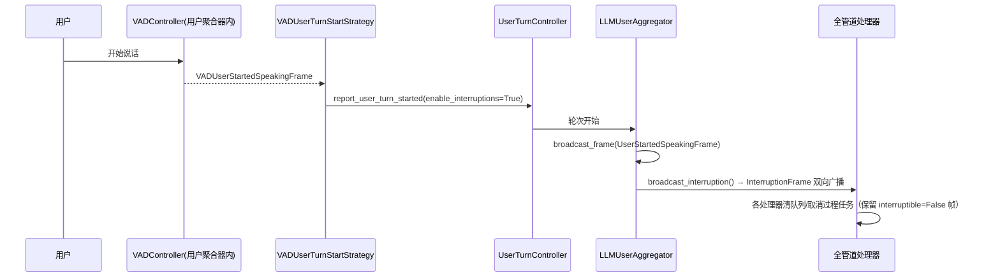
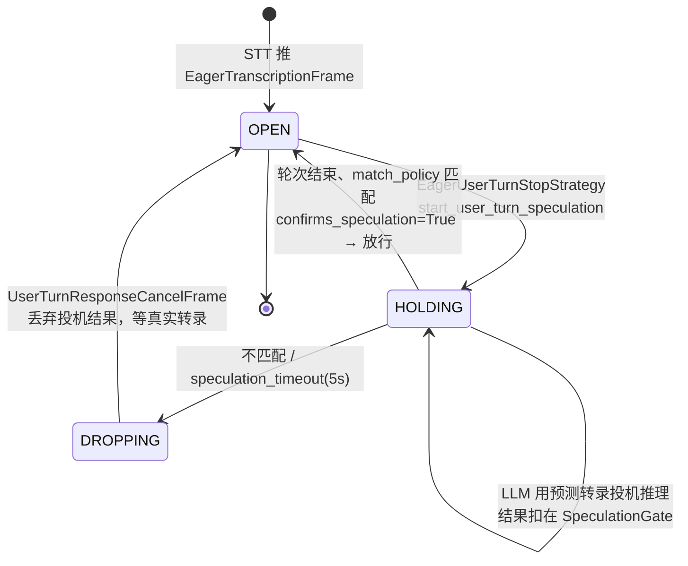

# 07 · 轮次管理与打断

[← 上一章：LLM 上下文与聚合器](06-llm-context-aggregation.md) | [Wiki 首页](README.md) | [下一章：传输层与序列化器 →](08-transports-serializers.md)

> **本页要点**
>
> - 轮次管理 = **策略组合**：start 策略（用户何时开口）、stop 策略（用户何时说完）、mute 策略（何时屏蔽用户）
> - 决策模式：start 默认 **FIRST**（第一个策略拍板），stop 默认 **ALL**（全员同意）；策略合并支持 REPLACE/EXTEND
> - 打断不是 VAD 直接推帧：VAD → start 策略 → `UserTurnController` → 聚合器 `broadcast_interruption()`
> - `InterruptionFrame`（停已播出的）与 `UserTurnResponseCancelFrame`（撤回还没播的投机回答）是两回事
> - eager 模式：STT 预测轮次结束 → 投机推理 → SpeculationGate 扣住结果 → 转录确认放行

源码：`src/pipecat/turns/`。核心文件职责：

| 文件 | 职责 |
| ---- | ---- |
| `user_turn_controller.py` | 轮次状态机：聚合各策略决策、管理 stop 超时看门狗、自己运行轮次推理（`:59-80` docstring） |
| `user_turn_processor.py` | 独立 `FrameProcessor` 版轮次管理器（可多聚合器共享） |
| `user_turn_strategies.py` | 策略容器与合并/决策参数 |
| `speculation_gate.py` | 投机响应的门：OPEN / HOLDING / DROPPING |
| `user_idle_controller.py` | bot 说完后的用户沉默检测 → `on_user_turn_idle` |
| `empty_user_turn.py` | 无转录轮次的恢复配置 |
| `eager_end_of_turn_mixin.py` | 给 STT 加「预测轮次结束」能力 |
| `user_start/`、`user_stop/`、`user_mute/` | 三类策略实现 |

## 7.1 策略如何组合与决策

```python
# turns/user_turn_strategies.py:63-100
@dataclass
class UserTurnStrategiesParams:
    start_merge_mode: MergeMode = MergeMode.REPLACE   # 用户策略整体替换服务推荐
    stop_merge_mode: MergeMode.REPLACE
    start_mode: StrategyMode = StrategyMode.FIRST     # start：第一个拍板
    stop_mode: StrategyMode = StrategyMode.ALL        # stop：全员同意
```

**默认组合**（`user_turn_strategies.py:403-427`、`:134-140`）：

- start：`[VADUserTurnStartStrategy, TranscriptionUserTurnStartStrategy]`
- stop：`[TurnAnalyzerUserTurnStopStrategy(LocalSmartTurnAnalyzerV3)]`

`UserTurnStrategies.merge_with(recommended, params)`（`:142-170`）决定「服务推荐的策略」与「用户配置的策略」如何合流：

- **REPLACE**：直接用用户配置。
- **EXTEND**：(服务推荐 or 默认) + 用户的扩展列表（`__post_init__` 里区分「主列表」与「扩展列表」）。

决策语义（`user_turn_controller.py:59-80`）：

- **FIRST**：start 默认——任何 start 策略第一个报告轮次开始即生效。
- **ALL**：stop 默认——所有监听用户的 stop 策略都决策后才结束轮次。`UserTurnController` 在此模式下**自己运行轮次推理**，`waits_for_inference=True` 的策略（如 LLM 完成度策略）在这次推理上做最终决策；推理被取消则基于它的 stop 决策作废。
- 轮次 stop 时若 VAD 仍显示用户在说话，结束动作挂起、决策保留，等用户真正停下（`:676-691`）。

## 7.2 Start 策略（用户何时开口）

基类 `BaseUserTurnStartStrategy`（`user_start/base_user_turn_start_strategy.py:44`）的关键接口：`process_frame(frame)`、`report_user_turn_started(*, enable_interruptions, enable_user_speaking_frames)`（`:219-254`）——**是否打断 bot、是否广播 UserStartedSpeakingFrame 由策略带参数报告**。

| 策略类 | 文件 | 触发条件 | 备注 |
| ---- | ---- | ---- | ---- |
| `VADUserTurnStartStrategy` | `vad_user_turn_start_strategy.py:14` | 收到 `VADUserStartedSpeakingFrame` | 默认主力 |
| `TranscriptionUserTurnStartStrategy` | `transcription_user_turn_start_strategy.py:13` | `InterimTranscriptionFrame`（默认）或 `TranscriptionFrame` | VAD 失效（用户声音太小）时的兜底 |
| `MinWordsUserTurnStartStrategy` | `min_words_user_turn_start_strategy.py:17` | bot 在说话时需 ≥ `min_words` 个词才打断；bot 沉默时 1 个词即起轮 | 不达标 → `trigger_reset_aggregation()` 丢弃已聚合词 |
| `WakePhraseUserTurnStartStrategy` | `wake_phrase_user_turn_start_strategy.py:36` | 终转写正则匹配唤醒词进入 AWAKE；窗口期内开口/转写即起轮 | "Hey bot" 类交互；唤醒词前的语音被丢弃 |
| `ExternalUserTurnStartStrategy` | `external_user_turn_start_strategy.py:20` | 解析 `ProposedUserStartedSpeakingFrame`（自己拍板）或采纳 `UserStartedSpeakingFrame`（别处已宣布） | `resolves_proposed_turn_start_frames=True` |
| `KrispVivaIPUserTurnStartStrategy` | `krisp_viva_ip_user_turn_start_strategy.py:42` | VAD 后用 Krisp VIVA IP 模型判概率 > threshold（默认 0.5）：真打断还是 backchannel | 需 `krisp_audio` 包 + `.kef` 模型 |

## 7.3 Stop 策略（用户何时说完）——语音对话最难的问题

| 策略类 | 文件 | 机制 |
| ---- | ---- | ---- |
| `SpeechTimeoutUserTurnStopStrategy` | `speech_timeout_user_turn_stop_strategy.py:28` | VAD stop 后跑双定时器：`user_speech_timeout`（默认 0.6s 地板）+ `stt_timeout`（由 `STTMetadataFrame.ttfs_p99_latency` 推导的安全网）；`TranscriptionFrame.finalized=True` 短路 |
| `TurnAnalyzerUserTurnStopStrategy` | `turn_analyzer_user_turn_stop_strategy.py:31` | 音频/VAD/转录喂 `BaseTurnAnalyzer`（默认 LocalSmartTurnAnalyzerV3）；报 COMPLETE 后等最终转录再结束；turn 结束时 `turn_analyzer.clear()` 防幻影 end-of-turn |
| `LLMTurnCompletionUserTurnStopStrategy` | `llm_turn_completion_user_turn_stop_strategy.py:30` | `waits_for_inference=True`。对**自己等的那次推理**读 marker：●/tool call/无 marker → 结束；◐/○ → 起 re-prompt 定时器（`incomplete_short/long_timeout`），到期 `report_user_turn_stopped()` + `LLMMessagesAppendFrame(run_llm=True)` 请 LLM 把用户拉回话题 |
| `ClassifierUserTurnStopStrategy` | `classifier_user_turn_stop_strategy.py:65` | 每次停顿问 classifier（`src/pipecat/classifiers/`）：complete 立即结束；short 等 5s；long 等 10s；**分类失败/超 1s 立即放行**——轮次绝不卡在分类器上 |
| `EagerUserTurnStopStrategy` | `eager_user_turn_stop_strategy.py:26` | 收 `EagerTranscriptionFrame` 即开始投机推理；轮次结束按 `match_policy` 比对提交的转录：匹配 → `confirms_speculation=True`（不二次推理）；不匹配或超 5s → `cancel_user_turn_speculation()` |
| `ExternalUserTurnStopStrategy` | `external_user_turn_stop_strategy.py:23` | 解析 `ProposedUserStoppedSpeakingFrame` 或采纳 `UserStoppedSpeakingFrame`；`wait_for_transcript=True` 时等最后转写后 0.5s 静默再决策 |
| `DeferredUserTurnStopStrategy` | `deferred_user_turn_stop_strategy.py:24` | **1.15.0 弃用**（No replacement）：controller 自己跑推理后，等推理的策略在两种模式下都能收尾，直接传被包策略即可 |
| `ExternalUserTurnCompletionStopStrategy` | `external_user_turn_completion_stop_strategy.py:22` | **1.15.0 弃用** → 建议 `ExternalUserTurnStopStrategy` + `ProposedUserStoppedSpeakingFrame` |

eager 匹配策略族（`eager_match_policy.py`）：`ExactMatch`（完全相等）与 `NormalizedMatch`（NFKC 归一后忽略大小写/撇号/标点/空白差异）。

## 7.4 Mute 策略（何时屏蔽用户）

基类 `BaseUserMuteStrategy`（`user_mute/base_user_mute_strategy.py:14`）：`process_frame(frame) -> bool`（返回当前是否静音）。生效点在 `LLMUserAggregator._maybe_mute_frame`（`llm_response_universal.py:1338-1383`）：静音时抑制 `InterruptionFrame`、VAD 帧、`InputAudioRawFrame`、转录帧、`UserBackchannelFrame` 等（生命周期帧永不静音）。

| 策略类 | 行为 |
| ---- | ---- |
| `AlwaysUserMuteStrategy` | bot 说话期间始终静音（跟踪 `BotStarted/StoppedSpeakingFrame`） |
| `FirstSpeechUserMuteStrategy` | 仅 bot **第一次**说话期间静音，之后永久放行 |
| `FunctionCallUserMuteStrategy` | 有函数调用执行中即静音（按 `tool_call_id` 集合跟踪） |
| `MuteUntilFirstBotCompleteUserMuteStrategy` | 从会话开始就静音直到 bot 完成第一次说话；bot 首次开口前报错也释放静音，避免失败开场把用户永久锁死 |

## 7.5 打断（Interruption）全链路

**打断不是 VAD 直接推 `InterruptionFrame`**。完整链路：



关键代码（`llm_response_universal.py:1509-1515`）：

```python
if params.enable_user_speaking_frames:
    await self.broadcast_frame(UserStartedSpeakingFrame)
await self._user_idle_controller.process_frame(UserStartedSpeakingFrame())
if params.enable_interruptions:
    await self.broadcast_interruption()
```

`enable_interruptions` 来自 start 策略的 `UserTurnStartedParams`——也就是说**轮次开始策略拥有「是否打断」的最终决定权**（如 `MinWords` 策略判定不足以打断时，`enable_interruptions=False`，bot 继续说）。

### 7.5.1 打断发生时各方做什么

| 角色 | 行为 |
| ---- | ---- |
| 每个处理器 | `_start_interruption()`：当前帧可打断 → 取消重建过程任务；不可打断 → 只清队列保留关键帧（`frame_processor.py:1161-1188`） |
| `LLMService` | 取消所有 `cancel_on_interruption=True` 的函数调用（`llm_service.py:998-999`）；SpeculationGate 遇打断 → `_discard()` |
| 助手聚合器 | 半截回复**提交进上下文**（`interrupted=True`）并 reset（`:2735-2761`） |
| 输出传输 | 清空音频队列但保留 uninterruptible 段；清完补发 `BotStoppedSpeakingFrame`（`base_output.py:609-646`） |

「bot 把关键句说完」的能力来自同一机制：`TTSSpeakFrame.interruptible=False` → 其合成音频块继承标志 → 打断后继续播完（`base_output.py:660` `_buffer_audio(resampled, uninterruptible=not frame.interruptible)`）。

### 7.5.2 打断 vs 撤回投机响应

| | `InterruptionFrame` | `UserTurnResponseCancelFrame` |
| ---- | ---- | ---- |
| 场景 | bot **已经在说**，用户插话 | bot **还没出声**（投机回答被扣在门里） |
| 动作 | 清帧、取消任务、停指标 | 撤回投机响应，轮次仍开放 |
| 触发 | 轮次开始 / 轮次恢复时 `enable_interruptions` | eager 投机转录被否决、用户在开放轮次再开口且不允许打断 |

（定义见 `frames.py:1425-1433` 与 `:1462-1483`。）

## 7.6 投机推理（Speculation）：提前 300ms 的艺术

eager 模式的完整时序：



- `SpeculationGate`（`speculation_gate.py`）由 `LLMService` 托管：`begin_speculation()` 开始持有、`process()` 同步决策、`_release()` 在 `UserStoppedSpeakingFrame` 时放行、`_discard()` 在打断/撤回时丢弃。
- 用户在开放轮次再开口（`_on_user_turn_resumed`，`llm_response_universal.py:1456-1468`）：允许打断 → `broadcast_interruption()` + 回答作废；不允许 → 只广播撤回帧，不打断。

## 7.7 兜底与恢复机制

| 机制 | 位置 | 说明 |
| ---- | ---- | ---- |
| stop 超时看门狗 | `user_turn_controller.py:705-723` | `user_turn_stop_timeout`（默认 5s）内无策略决策 → 强制结束轮次 |
| 音频空闲超时 | `LLMUserAggregatorParams.audio_idle_timeout=1.0` | SPEAKING 状态收不到音频帧 → 强制 speech stop |
| 用户空闲检测 | `user_idle_controller.py` + `user_idle_timeout` | bot 说完后开始计时，超时触发 `on_user_turn_idle`（主动续话的场景） |
| 空轮次恢复 | `empty_user_turn.py` + `_maybe_recover_empty_user_turn`（`:1704-1747`） | 用户开口但没产生转录（叹气、清嗓子）：`EmptyUserTurnConfig(interrupted_prompt=..., max_consecutive_recoveries=1)` 决定是否发一条 prompt 让 bot 反问 |

## 7.8 小结

- **策略即配置**：start/stop/mute 三类策略都是 `LLMUserAggregatorParams` 里的列表，REPLACE/EXTEND 决定与服务推荐如何合流。
- **打断是策略的意志**：`enable_interruptions` 由 start 策略报告——「三个词以上才能打断 bot」这类产品规则就是一个策略的事。
- **两套兜底**：时间兜底（stop 看门狗、audio_idle）与语义兜底（marker 协议、classifier、empty user turn 恢复）。
- eager 投机推理是延迟优化的极致：预测 → 提前推理 → 门控放行，错了就撤，对的话 bot 快了一个节拍。

[← 上一章：LLM 上下文与聚合器](06-llm-context-aggregation.md) | [Wiki 首页](README.md) | [下一章：传输层与序列化器 →](08-transports-serializers.md)
