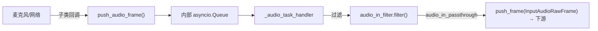
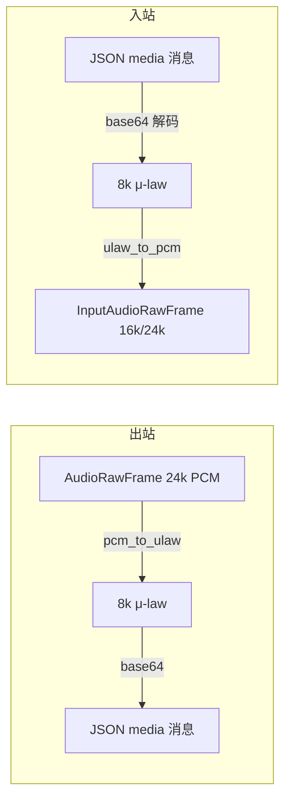

# 08 · 传输层与序列化器

[← 上一章：轮次管理与打断](07-turn-management.md) | [Wiki 首页](README.md) | [下一章：AI 服务集成 →](09-services.md)

> **本页要点**
>
> - 传输 = 一对 `input()` / `output()` 处理器；`TransportParams` 是通用参数基类，各传输派生自己的 Params
> - **v1.15 的 VAD 已从传输层移出**：`vad_analyzer` 挂在 `LLMUserAggregatorParams` 上，传输层只管音频入帧化
> - 输出传输按 10ms×N 分块播放、按 `interruptible` 标志分组缓冲音频、打断时清可打断段
> - 电话接入 = WebSocket 传输 + 对应 `FrameSerializer`（μ-law 8kHz ↔ 管线 PCM 16k/24k 重采样）
> - 开发 runner（`pipecat.runner.run`）一个 FastAPI 应用同时托管 webrtc/daily/livekit/websocket/电话多传输

源码：`src/pipecat/transports/`、`src/pipecat/serializers/`、`src/pipecat/runner/`。

## 8.1 BaseTransport：一对处理器的容器

```python
# transports/base_transport.py:150-191（接口节选）
class BaseTransport(BaseObject):
    # Transport base class as a container for input and output transport
    # frame processors.

    @abstractmethod
    def input(self) -> FrameProcessor:
        """Returns the input transport frame processor."""

    @abstractmethod
    def output(self) -> FrameProcessor:
        """Returns the output transport frame processor."""
```

- 构造参数：`name` / `input_name` / `output_name`。
- 事件由各具体传输注册，通用名是 **`on_client_connected`** / **`on_client_disconnected`**（不存在 `on_client_closed`）。
- `capture_participant_video(participant_id, framerate=30, video_source="camera", on_request_only=False)`：按需捕获参与者视频（`framerate=0` 自 1.13.0 弃用，改 `on_request_only=True`）。
- `get_client_id(client)`：把事件里的 client 映射为 participant_id。

## 8.2 TransportParams：通用参数基类

```python
# transports/base_transport.py:56-141（全部字段）
@dataclass
class TransportParams:
    audio_out_enabled: bool = False
    audio_out_sample_rate: int | None = None
    audio_out_channels: int = 1
    audio_out_bitrate: int = 96000
    audio_out_10ms_chunks: int = 4
    audio_out_filter: BaseAudioFilter | None = None
    audio_out_volume: float = 1.0
    audio_out_mixer: BaseAudioMixer | dict[str, BaseAudioMixer] | None = None
    audio_out_destinations: list[str] = []
    audio_out_end_silence_secs: int = 2
    audio_out_auto_silence: bool = True
    audio_out_write_timeout_secs: float = 10.0
    audio_in_enabled: bool = False
    audio_in_sample_rate: int | None = None
    audio_in_channels: int = 1
    audio_in_filter: BaseAudioFilter | None = None
    audio_in_stream_on_start: bool = True
    audio_in_passthrough: bool = True
    video_in_enabled: bool = False
    video_in_sources: dict[str, VideoInSourceParams] = {}   # "camera"/"screenVideo"/自定义
    video_out_enabled: bool = False
    video_out_is_live: bool = False
    video_out_width: int = 1024
    video_out_height: int = 768
    video_out_framerate: int = 30
    video_out_color_format: str = "RGB"
    video_out_codec: str | None = None
    video_out_destinations: list[str] = []
```

常用字段解读：

| 字段 | 说明 |
| ---- | ---- |
| `audio_out_10ms_chunks=4` | 每 40ms 写一次设备（见 8.4 出站管线） |
| `audio_in_passthrough=True` | 输入音频是否原样向下游转发（下游通常要喂 VAD/STT） |
| `audio_out_mixer` | 混音器（单一或 `{destination: mixer}` 映射）；队空时自动混静音 |
| `audio_out_end_silence_secs=2` | `EndFrame` 后补 2 秒静音，防尾部爆音 |
| `audio_out_write_timeout_secs=10` | 写设备超时 → `push_error(..., force_treat_as_permanent=True)` 判定对端失联 |
| `video_in_sources` | 仅 Daily / LiveKit / SmallWebRTC 支持（validator 强制与 `video_in_enabled` 同开，其它传输告警忽略） |

## 8.3 BaseInputTransport：把世界变成帧



- 子类把设备音频经 `push_audio_frame(InputAudioRawFrame)` 送入内部队列；音频任务（0.5s 取帧超时）过滤后下行（`base_input.py:318-361`）。
- **上游推下来的 `InputAudioRawFrame` 也走同一路径**（`:289-293`）——RTVI 客户端推音频就是这么进管线的。
- `InputTransportMessageFrame` 广播为自定义事件；`InputDTMFFrame` 由电话序列化器 / Daily/LiveKit SIP 事件 / RTVI 按键产生。
- **VAD 不在这里**：`VADProcessor`（`processors/audio/vad_processor.py:34`）是独立处理器，包装 `VADController` 产出 `VADUserStartedSpeakingFrame` 等帧；`vad_analyzer` 实例挂在 `LLMUserAggregatorParams` 上。

## 8.4 BaseOutputTransport：帧变成世界

输出传输的核心是每个目的地一个 `MediaSender`（`base_output.py:426`），各自持**三个队列**：音频帧队列、带 pts 的时钟队列、视频队列。

音频出站管线（`base_output.py:643-666`、`:1019-1050`）：

1. **重采样**到输出采样率；
2. **按 `interruptible` 分组**：`_buffer_audio(resampled, uninterruptible=not frame.interruptible)`，连续音频按标志分成 run；
3. **凑 chunk**：`audio_bytes_10ms = int(sample_rate / 100) * channels * 2`，乘 `audio_out_10ms_chunks`；chunk 继承所在 run 的可打断标志；
4. **写设备**：`asyncio.wait_for(write_audio_frame(frame), timeout=audio_out_write_timeout_secs)`，超时按对端失联处理。

打断行为（`handle_interruptions`，`:609-641`）：保留任务、`reset()` 两个队列——**只丢可打断帧**；uninterruptible run 继续播；若清完后无剩余音频，立即补发 `BotStoppedSpeakingFrame`。

其它出站细节：

| 机制 | 说明 |
| ---- | ---- |
| TTS 收尾 | `handle_tts_stopped` 把重采样尾巴+不满 chunk 的余量补静音凑整入队，再发 `TTSStoppedFrame` → `_bot_stopped_speaking()` |
| Bot speaking 事件 | `BotStarted/StoppedSpeakingFrame` 双向广播（互设 `broadcast_sibling_id`）；`BotSpeakingFrame` 每 0.2s |
| DTMF 出站 | 原生支持（`_supports_native_dtmf`，Daily 支持）否则生成 DTMF 音调当音频写 |
| 音画同步 | `OutputImageRawFrame.sync_with_audio=True` 的图走音频队列；否则进视频队列或作循环图 |
| 音量 | `VolumeFrame`/`VolumeGainFrame` 运行时调 `volume × volume_gain` |

## 8.5 各传输实现一览

| 传输 | 类 | Params | 一句话 |
| ---- | ---- | ---- | ---- |
| Daily | `transports/daily/transport.py` → `DailyTransport` | `DailyParams` | 全功能 WebRTC：音视频、转写、录制、SIP dial-in/out、app message；`camera_out_enabled=True` 默认开 |
| LiveKit | `transports/livekit/transport.py` → `LiveKitTransport` | `LiveKitParams` | LiveKit 房间；participant_id 一律是 identity 而非 SID；`audio_in_user_tracks=True` 按用户分轨 |
| WebSocket 服务端 | `transports/websocket/fastapi.py` → `FastAPIWebsocketTransport` | `FastAPIWebsocketParams` | 电话与自建客户端主力：`serializer` 字段挂序列化器、`fixed_audio_packet_size` 定长分包、`allowed_origins` 源校验 |
| WebSocket 单客户端 | `transports/websocket/server.py` → `SingleClientWebsocketServerTransport` | `SingleClientWebsocketServerParams` | 纯 `websockets` 库实现，evals/本地调试用（旧 `WebsocketServer*` 是 1.4.0 弃用别名） |
| WebSocket 客户端 | `transports/websocket/client.py` → `WebsocketClientTransport` | `WebsocketClientParams` | bot 作为客户端连远端 WS |
| RTVI 客户端 | `transports/websocket/rtvi_client.py` → `RTVIClientTransport` | — | 以 RTVI 协议连 bot 的 WS 服务端（`client-ready`/`bot-ready` 握手） |
| SmallWebRTC | `transports/smallwebrtc/transport.py` → `SmallWebRTCTransport` | 直接用 `TransportParams` | 裸 aiortc P2P；`SmallWebRTCConnection` 封装信令/ICE；WhatsApp 云通话也跑在它上面 |
| 本地音频 | `transports/local/audio.py` → `LocalAudioTransport` | `LocalAudioTransportParams` | PyAudio 麦克风/扬声器，本机跑 bot |
| 本地桌面 | `transports/local/tk.py` → `TkLocalTransport` | `TkTransportParams` | Tkinter 窗口视频 + PyAudio |
| Vonage Video | `transports/vonage/video_connector.py` → `VonageVideoConnectorTransport` | `VonageVideoConnectorTransportParams` | Vonage Video Connector WS 会话 |
| MoQ | `transports/moq/transport.py` → `MOQTransport` | `MOQParams` | Media over QUIC：发布/订阅音频与 RTVI 转录流 |
| HeyGen / Tavus / LemonSlice | 各自 `transport.py` | `HeyGenParams` / `TavusParams(DailyParams)` / `LemonSliceParams(DailyParams)` | 数字人：bot 加入与 Avatar 相同的（Daily）房间，音频经 API 送达 Avatar |
| WhatsApp | `transports/whatsapp/client.py` → `WhatsAppClient` | — | **没有 Transport 类**：Cloud API webhook + `SmallWebRTCConnection` 承载媒体，runner 挂 webhook 路由 |

Daily 事件全景（节选，`daily/transport.py:2587-2618`）：`on_participant_joined/left/updated`、`on_first_participant_joined`、`on_app_message`、`on_dialin_connected/ready/stopped/error`、`on_dialout_answered/connected/...`、`on_dtmf_event`、`on_transcription_message`、`on_recording_started/stopped`、`on_before_leave` 等；`on_client_connected/disconnected` 是 participant joined/left 的别名。

## 8.6 序列化器：电话协议的翻译官

```python
# serializers/base_serializer.py:84-108
class FrameSerializer(BaseObject):
    @abstractmethod
    async def serialize(self, frame: Frame) -> str | bytes | None: ...
    @abstractmethod
    async def deserialize(self, data: str | bytes) -> Frame | None: ...
```

- 返回 `None` 表示「本帧不处理，或正在缓冲稍后合并发出」。
- `InputParams.ignore_rtvi_messages=True`（默认）：RTVI 消息不外发到电话流。
- `setup(setup)` 接收管线采样率，供重采样。

全部序列化器：

| 文件 | 类 | 采样率 | 备注 |
| ---- | ---- | ---- | ---- |
| `twilio.py` | `TwilioFrameSerializer` | 8000（μ-law） | `auto_hang_up=True`：EndFrame 时 REST 主动挂断 |
| `plivo.py` | `PlivoFrameSerializer` | 8000 | |
| `vonage.py` | `VonageFrameSerializer` | **16000** | 电话家族中唯一 16k |
| `telnyx.py` | `TelnyxFrameSerializer` | 8000 | `inbound_encoding`/`outbound_encoding`（如 "PCMU"）可配 |
| `exotel.py` | `ExotelFrameSerializer` | 8000 | PCM 直传仅重采样 |
| `genesys.py` | `GenesysAudioHookSerializer` | 8000（PCMU/L16） | AudioHook 协议：open/opened 握手、ping/pong、pause/resume、Architect 变量 |
| `protobuf.py` | `ProtobufFrameSerializer` | — | 二进制帧（Text/Audio/Transcription/Interruption） |
| `rtvi_client.py` | `RTVIClientSerializer` | — | RTVI 客户端协议 |

**μ-law 流水线**（以 Twilio 为例，`twilio.py:216-343`）：



- 双向重采样器由 `create_stream_resampler(clear_after_secs=0.2)` 创建（Genesys 建议设 `None`）。
- DTMF：`{"event":"dtmf"}` ↔ `InputDTMFFrame`；打断：`InterruptionFrame` → `{"event":"clear"}`（让 Twilio 清播放缓冲）。

**serializer 如何选择**：没有注册表——直接作为 `FastAPIWebsocketParams.serializer` 传入。自动选择只发生在开发 runner：`transport_type` 探测出 provider（首条消息结构识别，`runner/utils.py:67-111`）后由 `_create_telephony_transport` 硬编码实例化对应 serializer。

## 8.7 开发 runner（`pipecat.runner`）

- **入口**：`runner/run.py::main()`（`:1878`）——argparse + uvicorn 起 FastAPI，默认端口 7860。
- **bot 约定**：每个 bot 必须实现 `async def bot(runner_args)`（docstring 原话："All bots must implement a `bot(runner_args)` async function as the entry point"）；发现顺序：`__main__` 有 `bot` → `import bot` → 扫描 cwd 下 `.py`。
- **CLI**：`--transport daily|eval|livekit|moq|vonage|webrtc|websocket|twilio|telnyx|plivo|exotel`、`--port`、`--proxy`（电话 webhook 公网代理）、`--esp32`（SDP munging）、`--whatsapp`、`--ws-auth token`、`--ice-servers` 等。
- **`create_transport(runner_args, transport_params)`**（`runner/utils.py:684`）：按 `RunnerArguments` 子类分发构造对应 transport；`WebSocketRunnerArguments.transport_type=None` 时按首条消息探测电话 provider 并回写 `CallData`。
- `/start` 请求体：`{"transport": "webrtc"|"daily"|"livekit"|"twilio"|...}`。

## 8.8 小结

- 传输是「一对处理器」；参数分两层：通用 `TransportParams` + 各传输 `*Params` 派生。
- 出站音频的一切行为（10ms 分块、打断清理、TTS 收尾补静音）都围绕 **chunk 继承 `interruptible`** 这一条规则。
- 电话 = WebSocket 传输 + 序列化器；serializer 无注册表，靠 Params 字段或 runner 自动探测。
- VAD 在 v1.15 已离开传输层——配置 `vad_analyzer` 请找 `LLMUserAggregatorParams`。

[← 上一章：轮次管理与打断](07-turn-management.md) | [Wiki 首页](README.md) | [下一章：AI 服务集成 →](09-services.md)
