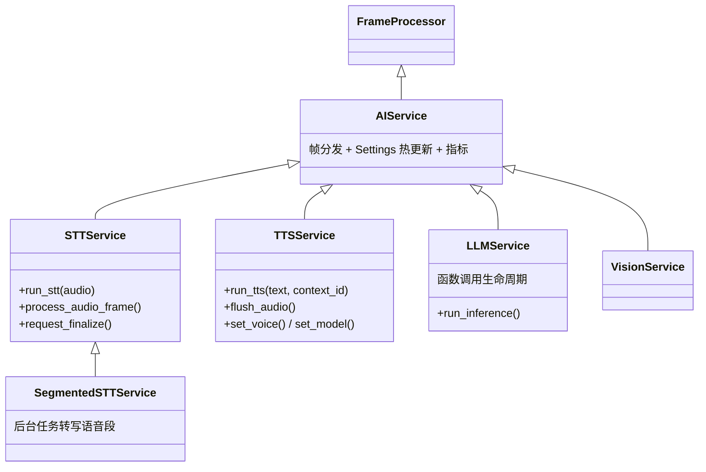

# 09 · AI 服务集成：60+ 供应商的统一抽象

[← 上一章：传输层与序列化器](08-transports-serializers.md) | [Wiki 首页](README.md) | [下一章：多 Worker 协作 →](10-multi-worker.md)

> **本页要点**
>
> - 五大服务基类：`AIService`（分发帧、Settings 模式）→ `STTService` / `TTSService` / `LLMService` / `VisionService`
> - 配置双层：Pydantic 的 `Service.Settings`（运行时可热更新）+ `Service.InputParams`（构造时一次性）
> - `SegmentedSTTService` 把每段语音的转写放进后台任务——`process_frame` 绝不阻塞
> - LLM 侧通过 `adapter_class` 翻译通用上下文；TTS 侧通过 expression adapter 表达情绪与拟声
> - 新增服务的七步清单来自 AGENTS.md，全部服务都在 `src/pipecat/services/`

## 9.1 服务基类体系



### 9.1.1 AIService：公共底座（`services/ai_service.py`）

- `process_frame`（`:238-270`）统一处理 `StartFrame`（记录采样率）、`EndFrame`、`CancelFrame`、`ServiceSwitcherRequestMetadataFrame`；其余帧转发给子类。
- **Settings 模式**：每个服务定义嵌套的 Pydantic `Settings` 类（如 `OpenAILLMService.Settings(system_instruction=...)`），构造时传入，运行中可用 `ServiceUpdateSettingsFrame` 热更新——`_update_settings(delta)` 返回实际生效的变更。
- 指标：`MetricsData(processor=..., model=...)`（`:83`），用量上报见 [12](12-observers-metrics.md)。

### 9.1.2 STTService（`services/stt_service.py`）

核心抽象是 `run_stt(audio: bytes) -> AsyncGenerator[Frame | None, None]`（`:335`）：子类实现它，把一段音频转成帧流（`TranscriptionFrame` / `InterimTranscriptionFrame`）。框架侧的完整机制：

| 成员 | 行号 | 说明 |
| ---- | ---- | ---- |
| `process_audio_frame()` | `:421` | 接收 `InputAudioRawFrame`，交给 `run_stt` |
| `request_finalize()` / `confirm_finalize()` | `:209` / `:221` | commit/finalize 信号协议（`TranscriptionFrame.finalized` 的来源） |
| `service_metadata_frame()` | `:557` | `STTMetadataFrame` 携带 `ttfs_p99_latency`——stop 策略的安全网参数 |
| `emit_stt_usage_metrics()` | `:252` | 音频用量统计 |
| 事件 | `:80-88` | `on_connected` / `on_disconnected` / `on_connection_error` |
| `supports_ttfs()` | `:547` | 是否支持 time-to-first-speech 元数据 |

**SegmentedSTTService**（v1.15.0 清理过）：把每个语音段的转写放进 `create_task` 后台任务。原因写在 AGENTS.md 里——内联转写会让输入音频帧排在转写后面，下游 VAD 拿不到帧、打断检测失灵。

### 9.1.3 TTSService（`services/tts_service.py`）

核心抽象是 `run_tts(text: str, context_id: str) -> AsyncGenerator[Frame | None, None]`（`:808`）：文本进、音频帧流（`TTSAudioRawFrame`）出。

| 成员 | 行号 | 说明 |
| ---- | ---- | ---- |
| `tts_process_generator()` | `:861` | 把 `run_tts` 的生成器装配成帧流：`TTSStartedFrame` → 音频 → `TTSStoppedFrame` |
| `flush_audio(context_id)` | `:852` | 强制冲出聚合缓冲（短句即时播报） |
| `get_expression_adapter()` | `:484` | 本服务的表情适配器（见 9.4） |
| `add_text_transformer()` | `:671` | 注册文本变换器（发音矫正等） |
| `format_pronunciation()` / `supports_pronunciations()` | `:733` / `:750` | IPA 发音支持 |
| `create_context_id()` | `:839` | 一轮 TTS 请求的唯一 id，音频/时间戳都靠它关联 |
| 字级时间戳 | — | 服务在推送音频时附带 word timestamps，provider markup 记为一个带括号的「词」（见 9.4） |
| 事件 | `:154-166` | `on_connected` / `on_disconnected` / `on_connection_error` / `on_tts_request` |

### 9.1.4 LLMService（`services/llm_service.py`）

```python
# llm_service.py:303
class LLMService(UserTurnCompletionLLMServiceMixin, AIService, Generic[TAdapter]):
```

- **推理入口**：`process_frame`（`:986`）处理 `LLMContextFrame`（先 `begin_speculation`，再同步工具注册）与 `LLMRunFrame`；`run_inference()`（`:578`）执行实际调用。
- **输出**：流式 `LLMTextFrame` + `LLMFullResponseStartFrame`/`EndFrame` 边界帧；轮次完成 marker 由混入的 `UserTurnCompletionLLMServiceMixin` 处理（◐/○ 时 re-prompt）。
- **函数调用生命周期**：`on_function_calls_started` 事件（`:326`）→ `FunctionCallsStartedFrame` → 执行（`FunctionCallRunnerItem`，支持 `cancel_on_interruption`/`timeout`）→ `FunctionCallResultFrame`（`interruptible=False`）→ 助手聚合器写上下文并按 `run_llm` 决定下一轮。`FunctionCallParams`（`:171`）把 `pipeline_worker`、`app_resources` 都带给工具函数。
- **adapter**：`adapter_class` 类属性（`:341`）+ `get_llm_adapter()`（`:525`）——见 [06](06-llm-context-aggregation.md) 的翻译层。
- `accepts_intermediate_function_call_results()`（`:652`）、`reports_ttfat()`（`:636`）：不同 provider 的能力探针。

## 9.2 服务目录速览

`src/pipecat/services/` 按 provider 一个目录，共 60+。按能力分类（括号内是目录名）：

| 能力 | 供应商 |
| ---- | ---- |
| **LLM / 推理** | openai、anthropic、google（Gemini）、groq、deepseek、mistral、together、fireworks、perplexity、grok、nvidia、cerebras、sambanova、nebius、novita、crusoe、openrouter、ollama（本地）、qwen、aws（Bedrock）、azure |
| **STT 语音识别** | deepgram、assemblyai、gladia、speechmatics、soniox、cartesia、azure、google、aws、moonshine（本地）、whisper（本地）、funasr（本地）、keenable |
| **TTS 语音合成** | cartesia、elevenlabs、azure、google、aws、fish、rime、inworld、neuphonic、smallest、resembleai、speechify、minimax、baseten、camb、kokoro（本地）、piper（本地）、xtts（本地）、pocket_tts（本地）、asyncai、fal |
| **实时/Speech-to-Speech** | openai（Realtime）、google（Gemini Live）、aws（Nova Sonic）、azure（Voice Live）、ultravox、openclaw、heygen |
| **视觉/多模态** | google、openai、azure、moondream |
| **图像生成** | fal、google、openai（`image_service.py` 基类） |
| **数字人 Avatar** | heygen、tavus、simli、lemonslice（目录在 transports） |
| **其它** | mem0（记忆）、hume（情感）、meta、zoom_ai、mcp_service（MCP 工具接入）、stt_latency（TTFS p99 参考值） |

通用辅助基类：`websocket_service.py`（自定义 WebSocket 服务的骨架）、`mcp_service.py`（把 MCP 服务器暴露为 LLM 工具）、`image_service.py`。

## 9.3 Settings 双层配置

```python
# 官方示例模式（06-voice-agent.py 节选）
llm = OpenAILLMService(
    api_key=os.environ["OPENAI_API_KEY"],
    settings=OpenAILLMService.Settings(
        system_instruction="You are a helpful assistant in a voice conversation...",
    ),
)
```

| 层 | 类型 | 生命周期 | 例子 |
| ---- | ---- | ---- | ---- |
| `Settings` | Pydantic BaseModel（嵌套类） | 运行中可热更新（`ServiceUpdateSettingsFrame` / `LLMUpdateSettingsFrame`） | `system_instruction`、`model`、`voice`、`temperature` |
| `InputParams` | Pydantic BaseModel | 构造时一次性（`**kwargs` 传入） | `language`、`vad_analyzer`（STT 场景）、`pause_frames_processing` |

热更路径：应用推 `LLMMessagesAppendFrame` 改上下文 → 推 `LLMUpdateSettingsFrame` 换模型 → 服务 `_update_settings()` 应用并返回实际变更。**运行时切换语音/模型/语言不需要重建管道**。

## 9.4 表情表达能力（Expressive Conversation，alpha）

v1.15 新引入的能力体系：LLM 在回复中写表情标签（`[sadly]`、`[sigh]`），TTS 服务把它们转成 provider 自有的 markup 演绎出来，**标签本身不会被读出来**。开启方式是 `PipelineParams(enable_expressive_conversation=True)`（可选 `expression_policy`）。

- **`ExpressionCapabilities`**：每个 TTS 服务声明自己会演什么——`allows_free_text_delivery` / `allows_free_text_sounds`（provider 接受自由文本）或 `service_vocabulary`（把通用名映射到 provider 自己的叫法，按成员 key）。
- **通用枚举**（`src/pipecat/expressive/expression.py`）：`ExpressionDelivery`（六十多种语气：affectionate、angry、calm、excited、fast、fearful……）与 `ExpressionSound`（非语言的声：sigh、laugh 等）。
- **`ExpressionPolicy`**（`expressive/policy.py:64`）：控制「给 LLM 提供哪些标签、何时用」——`guidance`（行为准则行，如 MATCH_STYLE / SLOW_FOR_DETAILS / BREATHE）、`delivery`（可用语气白名单）、`sounds`（可用拟声白名单）。
- **`BaseExpressionAdapter`**（`adapters/tts/base_expression_adapter.py`）：按模型/voice 在 `get_expression_adapter()` 里选择；服务用它在 word timestamps 里把 provider markup 报成一个带括号的「词」，保证 word tracking 对齐。
- 现有适配器（`adapters/tts/services/`）：azure、cartesia、elevenlabs、fish、gemini、inworld、minimax、mistral、soniox。
- 不做表情的服务返回 `BaseExpressionAdapter()`（空实现）——「只有停顿不算表演能力」（AGENTS.md 规则）。

完整示例：`examples/expressive-conversation/`。

## 9.5 新增一个服务的七步清单（AGENTS.md）

1. 继承对应基类（`STTService` / `TTSService` / `LLMService` …）；
2. 实现必需的抽象方法（`run_stt` / `run_tts` / `run_inference` + adapter）；
3. 处理需要的帧；
4. **默认把收到的帧按来向推回**（DOWNSTREAM 来的 DOWNSTREAM 去）；
5. 失败时 push `ErrorFrame`（服务用 `fatal=False`，让应用有机会 failover）；
6. 有意义的话用 `MetricsData` 加指标；
7. 遵循 `src/pipecat/services/` 里现有服务的模式（Settings 嵌套类、`**kwargs` 传 InputParams、事件注册等）。

若服务支持表情演绎，还要按「Expression adapters」规范补 adapter、声明 capabilities、加进 `tests/test_universal_names.py` 的 `ADAPTERS`、在 `examples/expressive-conversation/` 加示例并在 `evals/release/manifest.yaml` 登记。

## 9.6 小结

- 五个基类 + 三个核心抽象方法（`run_stt` / `run_tts` / `run_inference`）就是全部契约——60+ 供应商的差异被压进 adapter 和 Params。
- **配置分两层**：`Settings` 热更新、`InputParams` 一次性；热更靠控制帧，不靠重建管道。
- STT 的性能铁律：转写进后台任务（`SegmentedSTTService`）；TTS 的时间戳铁律：markup 报成一个带括号的词。
- 表情体系是「LLM 写标签 → adapter 翻译 → TTS 演绎」的三段式，由 `ExpressionCapabilities` 声明能力、`ExpressionPolicy` 约束供给。

[← 上一章：传输层与序列化器](08-transports-serializers.md) | [Wiki 首页](README.md) | [下一章：多 Worker 协作 →](10-multi-worker.md)
