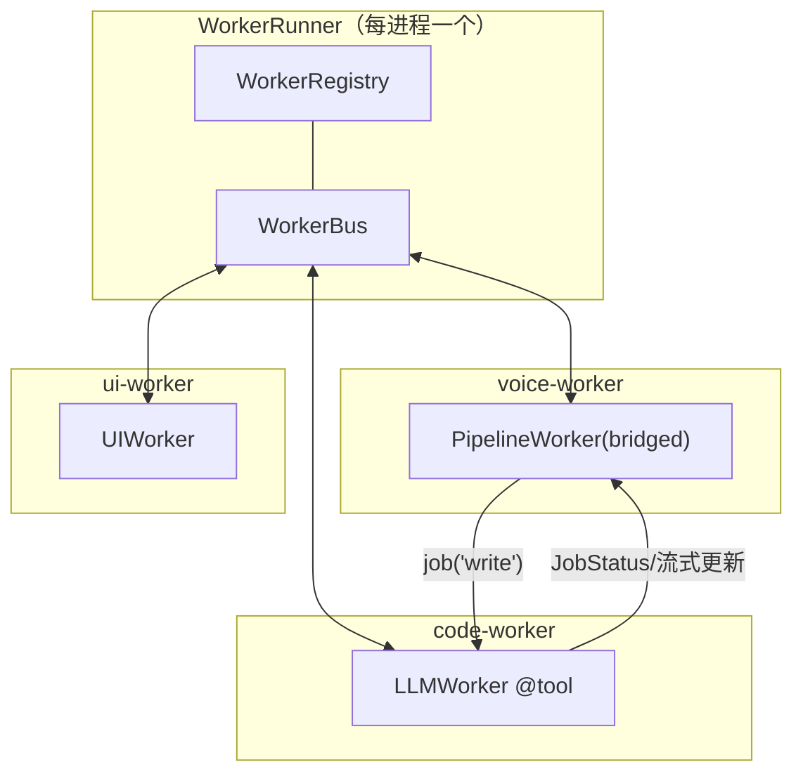
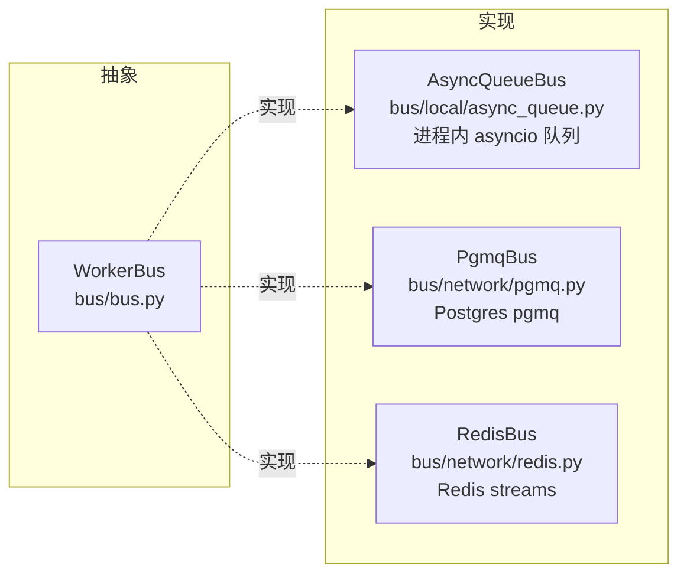
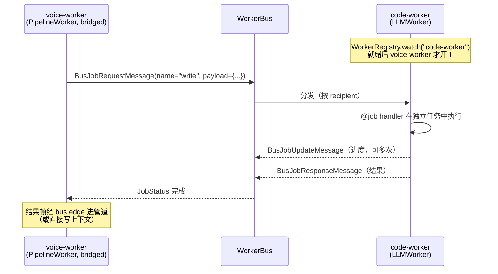

# 10 · 多 Worker 协作：Bus、Registry 与 Job RPC

[← 上一章：AI 服务集成](09-services.md) | [Wiki 首页](README.md) | [下一章：RTVI 协议 →](11-rtvi.md)

> **本页要点**
>
> - **Worker 是顶层可运行单元**（取代旧的 pipeline task）：`BaseWorker` 管激活、结束/取消、总线订阅、Job RPC
> - `WorkerBus` 是抽象 pub/sub：本地 `AsyncQueueBus`，分布式 `PgmqBus` / `RedisBus`——消息分普通数据与高优先级系统两类
> - `PipelineWorker(bridged=("voice",))` 让管道与总线交换帧；`WorkerRegistry.watch(name, handler)` 通知命名 Worker 就绪
> - **Job RPC**：Worker 用 `@job(name=..., sequential=...)` 暴露能力，调用方用 `self.job(...)` / `job_group(...)` 发请求等结果
> - 现成 Worker：`LLMWorker`（`@tool` 自动注册）、`LLMContextWorker`、`UIWorker`（经 RTVI 驱动 GUI）

> 术语约定（AGENTS.md）：「worker」是可运行单元；「task」只指 asyncio 任务；跨 Worker RPC 用「jobs / job groups」。

## 10.1 为什么要多 Worker

单条管道 = 单个 Agent。当一个 bot 需要专家协作——语音主管道 + 检索旁挂、多个专家并行辩论、交接（handoff）、甚至跨机器部署——Pipecat 的答案是：**每条管道一个 Worker，Worker 之间通过总线通信**。



示例仓库 `examples/multi-worker/` 有 9 个完整范例：`local-handoff`（本地交接）、`distributed-handoff`（pgmq/redis 分布式交接）、`parallel-debate`（并行辩论）、`remote-proxy-assistant`（远程代理）、`ui-worker`、`code-assistant`、`sensor-controller`、`openclaw-agent`、`llm-with-backend`。

## 10.2 BaseWorker 与激活

```python
# workers/base_worker.py:119
class BaseWorker(BaseObject, BusSubscriber):
```

- 构造参数：`name`（按名寻址）、`active=True`（启动即激活）、`check_dangling_tasks`、`task_manager`。
- `WorkerParams`（`:73`）只有一个字段 `task_manager`——Worker 由 Runner 注入任务管理器。
- **激活机制**：`WorkerActivationArgs`（`:86`，含 `metadata` dict）随 `BusActivateWorkerMessage` 送达；`LLMWorker` 派生 `LLMWorkerActivationArgs(messages=..., run_llm=...)`——被激活时注入上下文消息并立即推理。未激活的 Worker 仍接收生命周期消息：`_ALWAYS_DELIVERED = (BusActivateWorkerMessage, BusDeactivateWorkerMessage, BusEndWorkerMessage, BusCancelWorkerMessage)`（`base_worker.py:104-110`）——「把这些也门控掉，Worker 就永远无法被唤醒或关闭」。
- 默认 `run()`（`:392`）：只听总线消息（bus-only worker 的形态）。

## 10.3 WorkerBus：消息总线



- `BusSubscriber`（`bus/subscriber.py`）是接收侧 mixin：订阅 + `on_bus_message(message)` 回调（`WorkerRunner` 自己也用它）。
- **网络序列化**：`bus/serializers/json.py` 把消息转 JSON（跨进程必须）；`bus/adapters/` 提供 LLM 上下文与工具 schema 的跨 Worker 适配（`llm_context_adapter.py`、`tools_schema_adapter.py`）。

### 10.3.1 消息层级（`bus/messages.py`）

```python
BusMessage                       # :33  基础（id, sender, recipient, ...）
├── BusDataMessage               # :69  普通优先级
│   ├── BusFrameMessage          # :95  ★ 跨 Worker 传帧
│   ├── BusTTSSpeakMessage       # :120 让别的 Worker 说话
│   ├── BusFlushProgressMessage  # :138 flush 进度应答
│   ├── BusActivateWorkerMessage / BusDeactivateWorkerMessage   # :159/:170
│   ├── BusEndMessage / BusEndWorkerMessage                     # :177/:191
│   ├── BusWorkerReadyMessage    # :266
│   ├── BusJobRequestMessage / BusJobResponseMessage            # :322/:337
│   ├── BusJobUpdateMessage / BusJobUpdateRequestMessage        # :370/:399
│   └── BusJobStreamStartMessage / BusJobStreamDataMessage / BusJobStreamEndMessage  # :428-:454
└── BusSystemMessage             # :79  高优先级（生命周期/RPC控制）
    ├── BusCancelMessage / BusCancelWorkerMessage               # :204/:218
    ├── BusAddWorkerMessage    # :236 （同时是 BusLocalMessage）
    ├── BusWorkerRegistryMessage # :250
    ├── BusWorkerErrorMessage / BusWorkerLocalErrorMessage      # :289/:303
    ├── BusJobResponseUrgentMessage / BusJobUpdateUrgentMessage # :352/:383
    └── BusJobCancelMessage     # :410
```

设计意图与帧系统一致：**生命周期与取消必须能穿过拥堵**（对应帧里的 SystemFrame），普通数据排队走。

## 10.4 桥接：让管道与总线交换帧

```python
worker = PipelineWorker(pipeline, bridged=("code-worker",), name="voice-worker")
```

`bridged` 参数（`pipeline/worker.py:293`）：

| 取值 | 含义 |
| ---- | ---- |
| `None` | 不桥接（默认） |
| `()` | 包一层 bus 边缘处理器，接受**所有**桥的帧 |
| `("code-worker",)` | 只接受指定名字的桥发来的帧 |

- 实现：`BusBridgeProcessor`（`bus/bridge_processor.py`）+ `_BusEdgeProcessor`——源/汇两侧的「总线码头」，把管道帧装进 `BusFrameMessage` 发出、把到达的帧卸回管道。
- `exclude_frames`：额外排除跨总线的帧类型（生命周期帧永远排除）。
- 桥接 Worker 默认**不加 RTVI**（`enable_rtvi` 默认 None=bridged 时不加）：桥接的 Worker 没有自己的客户端，RTVI 会把每帧重复上报一遍。

## 10.5 Registry：谁在哪儿

```python
# registry/registry.py:19-102（接口节选）
class WorkerRegistry:
    def local_workers(self) -> list[str]: ...
    def remote_workers(self) -> list[str]: ...
    def get(self, worker_name: str) -> WorkerReadyData | None: ...
    async def watch(self, worker_name: str, handler: WatchHandler) -> None: ...
    async def register(self, worker_data: WorkerReadyData) -> bool: ...
```

- Runner 启动 Worker 时 `register(WorkerReadyData)`，就绪广播 `BusWorkerReadyMessage`。
- **`watch(name, handler)`**：命名 Worker 就绪即回调——多 Worker 场景的「等同伴上线再开工」就是它。装饰器版本：`@worker_ready(name="code-worker")`（`pipeline/worker_ready_decorator.py`）。

## 10.6 Job RPC：跨 Worker 调用

### 10.6.1 服务端：@job 装饰器

```python
# pipeline/job_decorator.py:9-52
def job(*, name: str, sequential: bool = False):
    """Mark a worker method as a job handler.

    Each request runs in its own asyncio task so the bus message loop
    is never blocked.

    Args:
        name: Job name to match. ...
        sequential: When True, requests with this name run one at a time
            in FIFO order. ... The wait time counts against the requester's
            timeout, so a slow predecessor can cause queued requests to
            time out before they start.
    """
```

- `BaseWorker` 初始化时沿 MRO 自动收集 `@job` 方法（`_collect_job_handlers`），请求到达即分派，**每个请求一个 asyncio 任务**。
- `sequential=True`：同名额 FIFO 串行（注意排队时间也算进调用方 timeout）。

### 10.6.2 调用方：job() 与 job_group()

```python
# base_worker.py:793-921（签名节选）
def job(self, worker_name: str | None = None, *,
        params: JobParams | None = None, name: str | None = None,
        payload: dict | None = None, timeout: float | None = None, ...): ...

def job_group(self, *worker_names: str, *,
              params: JobGroupParams | None = None, name: str | None = None,
              payload: dict | None = None, timeout: float | None = None,
              cancel_on_error: bool | None = None, ...): ...
```

| 调用形态 | 用法 | 适用 |
| ---- | ---- | ---- |
| `async with self.job("code-worker", name="write", payload={...}) as group:` | 单目标请求，await `JobStatus` 结果 | 交接、委托 |
| `async with self.job_group("w1", "w2", "w3", ...):` | **扇出**（fan-out）：同 payload 发给多个 Worker | 并行辩论、多评审 |
| 流式更新 | `BusJobUpdateMessage` / `BusJobStreamStart/Data/EndMessage` | 长任务的进度/数据流 |

超时、取消（`BusJobCancelMessage`）、`cancel_on_error`（组内一个失败取消全部）都有对应消息与参数。

## 10.7 现成的专用 Worker

| Worker | 文件 | 说明 |
| ---- | ---- | ---- |
| `LLMWorker(PipelineWorker)` | `workers/llm/llm_worker.py:69` | 自带 LLM 管道 + **`@tool` 自动注册**：`tool(fn=None, *, cancel_on_interruption=True, timeout_secs=None)`（`tool_decorator.py:7`），方法标记后经 `register_direct_function` 注册进 LLM 并进入 `build_tools()`；被激活时按 `LLMWorkerActivationArgs(messages, run_llm)` 注入上下文 |
| `LLMContextWorker` | `workers/llm/llm_context_worker.py` | LLMWorker + `LLMContext` 与聚合器对的封装 |
| `UIWorker` | `workers/ui/ui_worker.py` | 「an LLM worker that observes and drives a client GUI over RTVI」——观察 RTVI UI 事件、发 UI 命令/数据/作业组消息（`bus/ui/messages.py`），让前端 GUI 成为可被 LLM 驱动的一等公民 |
| `BackendLLMWorker` | `workers/llm/backend_llm_worker.py` | 配合 `pipeline/llm_with_backend/`（预测性委派：小模型先行、必要时转后端大模型） |

## 10.8 典型拓扑：语音主管道 + 专家旁挂



分布式部署时把 `AsyncQueueBus` 换成 `PgmqBus`/`RedisBus`，代码不变——拓扑在 Runner 组装处决定。

## 10.9 小结

- **Worker = 管道 + 生命周期 + 总线端点**；激活机制让 Worker 可以「待命——被消息唤醒——带参开工」。
- 消息总线复刻了帧系统的优先级哲学：取消/结束类消息永远畅通。
- Job RPC 是三件套：`@job` 暴露、`job()` 单发、`job_group()` 扇出；流式更新消息族支持长任务。
- `bridged=` 参数是把「管道」接入「多 Agent 世界」的那扇门；`LLMWorker` 的 `@tool` 则把「方法」变成「LLM 能力」。

[← 上一章：AI 服务集成](09-services.md) | [Wiki 首页](README.md) | [下一章：RTVI 协议 →](11-rtvi.md)
