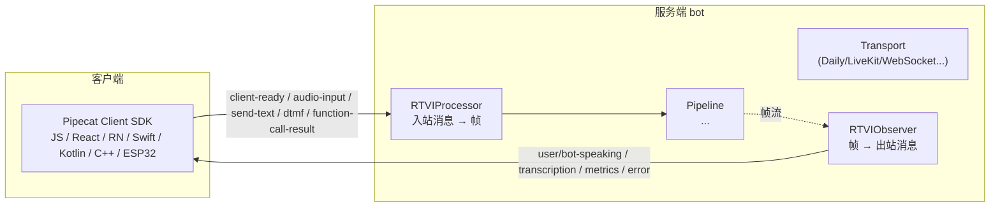

# 11 · RTVI 协议：客户端与管道的实时接口

[← 上一章：多 Worker 协作](10-multi-worker.md) | [Wiki 首页](README.md) | [下一章：观察者与指标 →](12-observers-metrics.md)

> **本页要点**
>
> - RTVI（Real-Time Voice Interface）是连接**客户端 SDK**（JS/React/Swift/Kotlin/C++/ESP32…）与管道的标准协议
> - 两个组件分工：`RTVIProcessor` 管**入站**（客户端→管道：文本输入、音频、DTMF、函数调用结果），`RTVIObserver` 管**出站**（管道→客户端：说话事件、转录、生命周期、指标、音频电平）
> - `PipelineWorker` 默认自动装 RTVI（bridged 除外）；`set_client_ready` / `set_bot_ready` 完成握手
> - 协议版本协商：观察者按客户端版本降级发送（2.2.0 起 raw text、2.3.0 起表情声音等）
> - 行为评估框架的 `EvalTransport` 就是一个 RTVI 客户端——评估跑在协议上

源码：`src/pipecat/processors/frameworks/rtvi/`（`processor.py`、`observer.py`、`models.py`、`frames.py`）。

## 11.1 RTVI 在架构中的位置



- `RTVIProcessor` 是**管道内的处理器**（默认由 `PipelineWorker` 自动插入，`enable_rtvi=True`），客户端消息从 transport 以 `InputTransportMessageFrame` 到达它，被翻译成帧推入管道。
- `RTVIObserver` 是**旁路观察者**（`rtvi_processor.create_rtvi_observer(params)` 创建），监听帧推送，把管道状态实时转成协议消息发给客户端。

## 11.2 RTVIProcessor：入站

```python
# processor.py:54-107（结构节选）
class RTVIProcessor(FrameProcessor):
    # Registered event handlers
    self._register_event_handler("on_bot_started")
    self._register_event_handler("on_client_ready")
    self._register_event_handler("on_client_message")
    self._register_event_handler("on_ui_message")
```

### 11.2.1 客户端可发的消息（入站能力）

| 客户端消息 | 处理方法 | 变成什么 |
| ---- | ---- | ---- |
| `client-ready`（含协议版本） | `_handle_client_ready`（`:390`） | 版本协商、回 `bot-ready`、`set_client_ready()` → `on_client_ready` 事件 |
| 文本输入 | `_handle_send_text`（`:475`） | 文本帧/消息帧进管道（即「打字和 bot 对话」） |
| 音频输入 | `_handle_audio_buffer`（`:438`） | 音频帧（WS 场景客户端推音频） |
| DTMF 按键 | `_handle_dtmf`（`:463`） | `InputDTMFFrame` |
| 文件发送 | `_handle_send_file`（`:508`） | `UserFileRawFrame` |
| 函数调用结果 | `_handle_function_call_result`（`:596`） | 回填等待中的外部函数调用 |
| 任意自定义 | `_handle_client_message`（`:582`） | `on_client_message` 事件（应用自己处理） |
| 观察者配置 | `RTVIConfigureObserverFrame` | 运行中增减出站消息类别 |

### 11.2.2 握手与公开方法

| 方法 | 行号 | 说明 |
| ---- | ---- | ---- |
| `set_client_ready()` | `:129` | 客户端就绪标记 |
| `set_bot_ready(about)` | `:135` | bot 就绪并向客户端发 `bot-ready`（`about` 携带能力描述） |
| `interrupt_bot()` | `:145` | 服务端主动打断 |
| `send_server_message(data)` / `send_server_response(...)` | `:149` / `:154` | 服务端→客户端任意消息 |
| `send_error(error)` | `:165` | 错误下发 |
| `client_version` property | `:110` | 协商出的客户端协议版本（如 `[2, 3, 0]`） |
| `handle_message(message)` | `:180` | 供程序化喂入协议消息 |

## 11.3 RTVIObserver：出站

```python
# observer.py:279
class RTVIObserver(BaseObserver):
```

观察者监听 `on_push_frame`（`:649`），按帧类型分发到各 `_handle_*` 方法（interruptions、VAD speaking、user mute、函数调用等），组装成 Pydantic 消息（`models.py`）后经 `send_rtvi_message()`（`:542`）发出——子类可覆写它走不同的发送通道。

### 11.3.1 出站消息类别（RTVIObserverParams，`observer.py:117-259`）

| 参数（默认） | 发送的消息 |
| ---- | ---- |
| `bot_speaking_enabled`（True） | bot started/stopped speaking、interrupted |
| `bot_llm_enabled`（True） | bot-llm-started/stopped（文本部分弃用 → `llm_raw_text_enabled`） |
| `bot_tts_enabled`（True） | bot-tts-started/stopped（文本部分弃用 → `tts_raw_text_enabled`） |
| `bot_output_enabled`（True） | bot 输出（TTS 念出的文本） |
| `user_speaking_enabled`（True） | 用户 started/stopped speaking（经轮次策略门控） |
| `user_input_enabled`（True） | 用户说了/打了什么（转录、backchannel、客户端文本） |
| `user_audio_level_enabled` / `bot_audio_level_enabled` | 音频电平（波形 UI 用） |
| `user_transcription_enabled` | **1.13.0 弃用**（No replacement，被 `user_input_enabled` 取代） |
| `vad_user_speaking_enabled`（**False**） | 原始 VAD 信号（未经轮次确认） |
| `bot_llm_marker_enabled`（**False**） | 轮次完成 marker 报告（评估用，不给普通客户端） |
| `stt_raw_text_enabled` / `llm_raw_text_enabled` / `tts_raw_text_enabled`（**False**） | 原始文本流（仅协议 ≥2.2.0 客户端） |
| `metrics_enabled` / `system_logs_enabled` | 指标 / 系统日志 |
| `ignored_sources` | 静默忽略某些处理器的帧（如旁挂评估 LLM），也可 `add_ignored_source()` 动态加 |
| `skip_text_types` | 跳过特定文本类型（backchannel 需 ≥2.2.0；表情声音/停顿需 ≥2.3.0） |

### 11.3.2 版本协商与降级

观察者内置客户端版本判断（`_is_legacy_client`、`_client_is_at_least`、`_client_supports_backchannels/expression/raw_text`，`:353-380`）：**同一份消息按客户端能力裁剪**——老客户端收不到新字段，新功能不破坏旧 SDK。函数调用上报粒度也有三档（`RTVIFunctionCallReportLevel`，`:96`）。

### 11.3.3 输出变换器

`add_bot_output_transformer(transform)`（`:382`）：注册一个 `async (text, text_type) -> str` 变换器，在发给客户端前改写 bot 输出（如剥敏感词、加 UI 标记）；`remove_bot_output_transformer` 移除。

## 11.4 客户端对接速览

服务端什么都不用做（默认已开 RTVI）；客户端一侧：

```js
// JS SDK 形态示意
const client = new PipecatClient({ transport: new DailyTransport() });
await client.connect({ botProfile: ... });
client.on("botStartedSpeaking", ...);
client.on("userTranscription", ...);
await client.sendText("帮我订个位子");        // → RTVIProcessor → 管道
```

| 场景 | 用什么 |
| ---- | ---- |
| Web/App 客户端 | 官方 SDK（RTVI 内建） |
| 自建 WS 客户端 | `transports/websocket/rtvi_client.py` 的 `RTVIClientTransport`（bot 侧）+ `RTVIClientSerializer` |
| 行为评估 | `pipecat.evals` 的 eval transport 就是 RTVI 客户端——`pipecat eval run` 用协议驱动一场真对话 |

## 11.5 与 UIWorker 的关系

`UIWorker`（[10](10-multi-worker.md)）在 RTVI 之上再进一步：客户端 GUI 的**状态与事件**经 `BusUIEventMessage`/`BusUICommandMessage`（`bus/ui/messages.py`）上总线，UIWorker 里的 LLM 观察并驱动 GUI（发 UI 快照、UI 作业组）。RTVI 负责「客户端 ↔ 管道」，UI Worker 负责「GUI ↔ 多 Agent」。

## 11.6 小结

- RTVI = **入站处理器 + 出站观察者**的固定组合，`PipelineWorker` 默认装配，应用几乎零成本获得客户端协议。
- 出站消息是**按类别开关 + 按客户端版本裁剪**的：`RTVIObserverParams` 十几个布尔值就是协议的可视面。
- 评估框架跑在 RTVI 上——「协议即测试面」，这也是 Pipecat 敢改内部实现而不破坏客户端的底气。

[← 上一章：多 Worker 协作](10-multi-worker.md) | [Wiki 首页](README.md) | [下一章：观察者与指标 →](12-observers-metrics.md)
