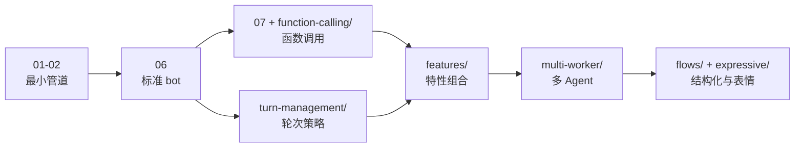

# 14 · 示例导读：examples/ 目录完全指南

[← 上一章：测试与行为评估](13-testing-evals.md) | [Wiki 首页](README.md)

> **本页要点**
>
> - `examples/getting-started/` 的 01→07 是官方学习路径，`06-voice-agent.py` 是「标准 bot 形态」
> - 所有示例共享同一入口协议：`async def bot(runner_args)` + `pipecat.runner.run`，一个文件可跑多传输（`--transport daily|webrtc|twilio|...`）
> - 25+ 个主题目录覆盖服务、特性、多 Worker、评估；每个示例都能独立运行

## 14.1 最小 bot 解析（getting-started/06）

`examples/getting-started/06-voice-agent.py`（139 行）是理解一切的起点，完整链路回顾：

```python
# 骨架（省略细节）
async def run_bot(transport: BaseTransport, runner_args: RunnerArguments):
    stt = DeepgramSTTService(api_key=os.environ["DEEPGRAM_API_KEY"])
    tts = CartesiaTTSService(api_key=os.environ["CARTESIA_API_KEY"], settings=...)
    llm = OpenAILLMService(api_key=os.environ["OPENAI_API_KEY"], settings=...)

    context = LLMContext()
    user_aggregator, assistant_aggregator = LLMContextAggregatorPair(
        context, user_params=LLMUserAggregatorParams(vad_analyzer=SileroVADAnalyzer()))

    pipeline = Pipeline([transport.input(), stt, user_aggregator, llm,
                         tts, transport.output(), assistant_aggregator])

    worker = PipelineWorker(pipeline,
        params=PipelineParams(enable_metrics=True, enable_usage_metrics=True),
        idle_timeout_secs=runner_args.pipeline_idle_timeout_secs,
        processor_unusable_policy=ProcessorUnusablePolicy.END)
    runner = WorkerRunner(handle_sigint=runner_args.handle_sigint)
    await runner.add_workers(worker)

    @transport.event_handler("on_client_connected")
    async def on_client_connected(transport, client):
        context.add_message({"role": "developer", "content": "请向用户做自我介绍。"})
        await worker.queue_frames([LLMRunFrame()])      # 开场白触发

    @transport.event_handler("on_client_disconnected")
    async def on_client_disconnected(transport, client):
        await runner.cancel()

    await runner.run()

async def bot(runner_args: RunnerArguments):
    transport = await create_transport(runner_args, transport_params)
    await run_bot(transport, runner_args)

if __name__ == "__main__":
    from pipecat.runner.run import main
    main()
```

值得注意的模式：

- **`transport_params` 字典 + lambda**：按传输名延迟构造参数（`:37-58`），同一 bot 支持 `eval / daily / livekit / twilio / webrtc` 五种传输。
- **`06a-voice-agent-local.py`**：把服务换成全本地（Moonshine STT + Ollama LLM + Kokoro TTS + LocalAudioTransport），零 API key 跑通。
- `bot()` 是开发 runner 与 Pipecat Cloud 共同的入口约定（见 [08](08-transports-serializers.md) 的 runner 一节）。

## 14.2 getting-started：学习路径（01→07）

| 示例 | 教什么 |
| ---- | ---- |
| `01-say-one-thing.py` | 最小管道：TTS 说一句话（无 LLM） |
| `01a-local-audio.py` | 本地音频传输 |
| `02-llm-say-one-thing.py` | 加入 LLM；`LLMContext` + 聚合器首次登场 |
| `03-still-frame.py` / `03a` | 输出一张静态图（视频输出） |
| `04-sync-speech-and-image.py` | 音画同步（`sync_with_audio`） |
| `05-speaking-state.py` | 监听 bot 说话状态事件 |
| `06-voice-agent.py` | **完整语音 agent**（上面已拆解） |
| `07-function-calling.py` | 函数调用：注册工具、处理结果、再触发推理 |

## 14.3 主题目录导览

### 服务类

| 目录 | 内容 |
| ---- | ---- |
| `voice/` | **最大的目录**：按供应商组合 STT+LLM+TTS 的完整 bot（`voice-aws.py`、`voice-azure.py`、`voice-assemblyai.py`、`voice-aicoustics*.py` 等），找「某家供应商怎么接」看这里 |
| `realtime/` | Speech-to-Speech 服务：`realtime-aws-nova-sonic*.py`、`realtime-azure-voice-live.py`、`realtime-gemini-live-*.py`（含异步工具、文件 API、搜索 grounding、本地驱动轮次、Vertex） |
| `transcription/` | 纯转写/翻译管线：Deepgram Flux、Cartesia Turns、Gladia 翻译、FunASR 等 |
| `vision/` | 视觉理解：`UserImageRequestFrame` 捕帧送 Anthropic/Gemini/OpenAI/Moondream |
| `image-generation/` | 文生图集成进语音对话 |
| `video-processing/` / `video-avatar/` | 视频处理与数字人（HeyGen/Tavus/Simli/LemonSlice） |

### 特性类

| 目录 | 内容 |
| ---- | ---- |
| `features/` | **特性百宝箱**：自定义帧处理器（`features-custom-frame-processor.py`）、事件前后钩子、`app_resources`、DTMF 菜单、并发 LLM 评估（RTVI ignored sources 的用法）、实时翻译、GPU 容器本地 bot 等 |
| `function-calling/` | 各供应商 + 各形态的函数调用（Anthropic 异步流、视频参数、Advanced FunctionSchema…） |
| `turn-management/` | **轮次策略专题**：classifier 轮次完成、外部自定义策略、用户空闲检测、eager end-of-turn、空轮次恢复、filter-incomplete-turns（配合函数调用/用户空闲）、打断配置、SmartTurn（本地/CoreML）、轮次追踪观察者 |
| `audio/` | 背景音、录音、音效、音量控制 |
| `observability/` | 心跳、自定义观察者、Sentry 指标上报 |

### 架构类

| 目录 | 内容 |
| ---- | ---- |
| `multi-worker/` | 九个多 Worker 范例（详见 [10](10-multi-worker.md)）：`local-handoff`、`distributed-handoff`（pgmq/redis）、`parallel-debate`、`remote-proxy-assistant`、`ui-worker`、`code-assistant`、`sensor-controller`、`openclaw-agent`、`llm-with-backend`（预测性委派） |
| `transports/` | 传输基线：daily / livekit / moq / small-webrtc / vonage 各一个最小示例 |
| `flows/` | Pipecat Flows 结构化对话（`python/` 与 `yaml/` 两种定义方式） |
| `context-summarization/` / `persistent-context/` / `rag/` | 上下文摘要、跨会话上下文、RAG 检索注入 |
| `expressive-conversation/` | 表情对话（alpha）：LLM 写表情标签、TTS 演绎（见 [09](09-services.md)） |
| `mcp/` | MCP 服务器接入为 LLM 工具（`mcp_service.py`） |
| `thinking/` | 推理模型思维链（LLMThought* 帧） |
| `update-settings/` | 运行中热更新服务设置 |
| `video-avatar/` | 数字人组合 |

## 14.4 运行任何一个示例

```bash
# 通用方式（runner 自动起 7860 端口的 FastAPI，支持多传输）
python examples/<dir>/<example>.py --transport daily    # 或 webrtc / websocket / twilio ...
python examples/<dir>/<example>.py --transport webrtc --port 7860

# 多 Worker 示例是独立应用（自带 README）
cat examples/multi-worker/README.md
```

环境变量（各示例的 API key）统一放 `.env`（`load_dotenv(override=True)` 是所有示例的标准第一行）；`env.example` 给了模板。行为验证见 [13](13-testing-evals.md)——大部分示例在 `evals/release/manifest.yaml` 里有对应场景。

## 14.5 学习路线建议



## 14.6 小结

- 示例是最好的 API 文档：`06-voice-agent.py` 一份代码覆盖 [02](02-core-architecture.md) 全部核心概念。
- 所有示例遵守同一个入口协议（`bot(runner_args)` + dev runner），「换个传输跑」是零成本实验。
- 遇到问题先找同类示例：轮次问题看 `turn-management/`，某供应商看 `voice/`，架构组合看 `multi-worker/`。

[← 上一章：测试与行为评估](13-testing-evals.md) | [Wiki 首页](README.md)
