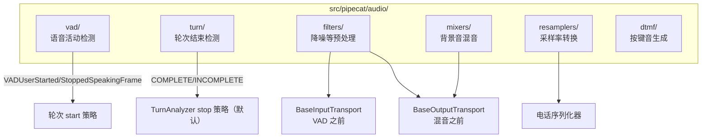

# 15 · 音频子系统：VAD、降噪、混音与轮次检测

[← 上一章：示例导读](14-examples-guide.md) | [Wiki 首页](README.md) | [下一章：Flows 与支撑模块 →](16-flows-and-support.md)

> **本页要点**
>
> - `src/pipecat/audio/` 是框架的音频「工具箱」：VAD 分析器、音频过滤器、混音器、重采样器、轮次检测、DTMF
> - **VAD**：`VADAnalyzer` 抽象基类 + 4 个实现（Silero 默认、WebRTC、Krisp、AIC），参数集中在 `VADParams`
> - **轮次检测（SmartTurn）**：`BaseTurnAnalyzer` 判定 `COMPLETE`/`INCOMPLETE`，是默认 stop 策略的底层模型
> - **过滤器**在 VAD 之前（输入）/混音之前（输出）处理音频——降噪就是在这里发生的
> - **重采样器**是电话序列化器（8k μ-law ↔ 管线 PCM）背后的引擎

## 15.1 模块全景



## 15.2 VAD：语音活动检测

### 15.2.1 接口与参数

```python
# audio/vad/vad_analyzer.py:63
class VADAnalyzer(ABC):
    """Abstract base class for Voice Activity Detection analyzers."""
```

```python
# audio/vad/vad_analyzer.py:47-60
class VADParams(BaseModel):
    """Configuration parameters for Voice Activity Detection.

    Parameters:
        confidence: Minimum confidence threshold for voice detection.
        start_secs: Duration to wait before confirming voice start.
        stop_secs: Duration to wait before confirming voice stop.
        min_volume: Minimum audio volume threshold for voice detection.
    """
    confidence: float = VAD_CONFIDENCE
    start_secs: float = VAD_START_SECS
    stop_secs: float = VAD_STOP_SECS
    min_volume: float = VAD_MIN_VOLUME
```

| 参数 | 含义 | 对话体验的影响 |
| ---- | ---- | ---- |
| `confidence` | 判定是人声的最低置信度 | 调高 → 误触发少，但轻声说话可能漏检 |
| `start_secs` | 连续多久有声才算「开始说话」 | 调大 → 不抢话，但打断反应变慢 |
| `stop_secs` | 连续多久无声才算「停止说话」 | 调大 → 不容易把停顿当说完，但响应变慢 |
| `min_volume` | 音量门槛 | 过滤键盘声/空调声 |

分析器输出 `VADState`（`vad_analyzer.py:31`），`VADController`（`vad_controller.py:71`）包装分析器、吃音频帧、产出 `VADUserStartedSpeakingFrame` / `VADUserStoppedSpeakingFrame`。

### 15.2.2 四个分析器实现

| 分析器 | 文件 | 说明 |
| ---- | ---- | ---- |
| `SileroVADAnalyzer` | `audio/vad/silero.py:146` | **默认选择**。Silero ONNX 模型本地推理（`SileroOnnxModel`），准确率高、CPU 占用低。示例标准配置：`LLMUserAggregatorParams(vad_analyzer=SileroVADAnalyzer())` |
| `WebRTCVADAnalyzer` | `transports/daily/transport.py:212` | Daily 自带的 WebRTC VAD（更轻量、更激进，依赖 Daily 房间） |
| `KrispVivaVadAnalyzer` | `audio/vad/krisp_viva_vad.py:34` | Krisp VIVA：设备端降噪 + 人声检测（需 `krisp_audio` 包 + `.kef` 模型） |
| `AICQuailVADAnalyzer` | `audio/vad/aic_quail_vad.py:46` | AI-Coustics Quail 模型 |

**接线位置**（v1.15 重要变化）：VAD 不再挂传输层，`vad_analyzer` 传给 `LLMUserAggregatorParams`，由用户聚合器内部的 `VADController` 驱动——VAD 信号与轮次策略天然在同一个决策点。

## 15.3 轮次检测（Turn Detection / SmartTurn）

「用户说完了吗」是语音对话最难的问题，纯 VAD 静默计时不够（用户思考时的「嗯……」会被误判说完）。Pipecat 用专门模型判定：

```python
# audio/turn/base_turn_analyzer.py:21-30
class EndOfTurnState(Enum):
    """State enumeration for end-of-turn analysis results.

    Parameters:
        COMPLETE: The user has finished their turn and stopped speaking.
        INCOMPLETE: The user is still speaking or may continue speaking.
    """
    COMPLETE = 1
    INCOMPLETE = 2
```

| 分析器 | 文件 | 说明 |
| ---- | ---- | ---- |
| `BaseTurnAnalyzer` | `audio/turn/base_turn_analyzer.py:39` | 抽象基类：`analyze_audio()` 吃音频流返回 `EndOfTurnState` |
| `LocalSmartTurnAnalyzerV2` / **`V3`** | `audio/turn/smart_turn/local_smart_turn_v2.py` / `v3.py` | 本地 ONNX SmartTurn 模型（whisper 特征提取在 `_whisper_features.py`）。**V3 是框架默认**（`default_user_turn_strategies` 用 `LocalSmartTurnAnalyzerV3`） |
| `LocalCoreMLSmartTurn` | `local_coreml_smart_turn.py` | macOS Core ML 加速版 |
| `HttpSmartTurn` | `http_smart_turn.py` | 调 Pipecat 云端接口，免本地模型 |
| `KrispVivaTurn` | `audio/turn/krisp_viva_turn.py` | Krisp 端侧轮次检测 |

消费方是 stop 策略 `TurnAnalyzerUserTurnStopStrategy`（见 [07](07-turn-management.md)）：VAD 报告停顿 → 把音频喂给分析器 → `COMPLETE` 才结束轮次（再等最终转录兜底）。策略会 `turn_analyzer.clear()` 防止幻影判定。相关示例：`examples/turn-management/turn-management-smart-turn-local.py`（及 CoreML 变体）。

## 15.4 音频过滤器（降噪等预处理）

```python
# audio/filters/base_audio_filter.py
class BaseAudioFilter(ABC):
    """Base class for transport audio filters.

    This is a base class for transport audio filters. If an audio filter is
    provided to the input transport it will be used to process audio before VAD
    and before pushing it downstream. If an audio filter is provided to the
    output transport it will be used to process the audio it receives before ...
    """
```

| 过滤器 | 文件 | 说明 |
| ---- | ---- | ---- |
| `RNNoiseFilter` | `filters/rnnoise_filter.py` | RNNoise 本地降噪（开源，无需密钥） |
| `KoalaFilter` | `filters/koala_filter.py` | Koala 增强降噪 |
| `AICFilter` | `filters/aic_filter.py` | AI-Coustics 语音增强 |
| `KrispVivaFilter` | `filters/krisp_viva_filter.py` | Krisp 降噪（与 VIVA VAD 同生态） |

- **接入点**：`TransportParams.audio_in_filter`（输入侧：VAD 与下游之前——先降噪再判人声，能显著降低误触发）与 `audio_out_filter`（输出侧：混音器之前；混音器/尾静音/DTMF 音等传输自产音频不经过）。
- 运行时控制帧：`FilterControlFrame` 系列（`frames.py:2902-2927`），过滤器可实现 `filter()` 处理帧并响应控制。

## 15.5 混音器、重采样器与 DTMF

### 15.5.1 混音器

- `BaseAudioMixer`（`audio/mixers/base_audio_mixer.py`）：输出侧混音抽象，`TransportParams.audio_out_mixer` 可传单个实例或 `{destination: mixer}` 映射。
- `SoundfileMixer`（`soundfile_mixer.py`）：把音频文件（背景音乐、环境音）混入 bot 语音，队空时输出混音结果（`audio_out_auto_silence=True` 时配合静音）。示例：`examples/audio/audio-bot-background-sound.py`。

### 15.5.2 重采样器

| 实现 | 文件 | 说明 |
| ---- | ---- | ---- |
| `SoxrResampler` / `SoxrStreamResampler` | `resamplers/soxr_resampler.py` / `soxr_stream_resampler.py` | soxr 库；**流式版本**是电话序列化器的默认选择（支持 `clear_after_secs` 在打断后清理残留样本） |
| `ResampyResampler` | `resampy_resampler.py` | resampy 库备选 |

电话场景的完整链路回顾（[08](08-transports-serializers.md)）：管线 16k/24k PCM ↔ `SoxrStreamResampler` ↔ 8k μ-law（`audio/utils.py` 的 `ulaw_to_pcm`/`pcm_to_ulaw`）。

### 15.5.3 DTMF

- `audio/dtmf/types.py`：`KeypadEntry`（0-9、*、#、A-D）等类型。
- `audio/dtmf/utils.py`：`load_dtmf_audio()` 生成按键音调——输出传输在传输不支持原生 DTMF 时用它把 `OutputDTMFFrame` 变成 `OutputAudioRawFrame` 播出。

### 15.5.4 其它

- `audio/volume.py`：音量处理（配合 `VolumeFrame`/`VolumeGainFrame`）。
- `audio/utils.py`：μ-law 编解码、WAV 封装（`pcm_to_wav`，LLM 音频消息用）等工具函数。

## 15.6 选型速查

| 需求 | 推荐 |
| ---- | ---- |
| 一般语音 bot 起步 | `SileroVADAnalyzer()` + 默认 `LocalSmartTurnAnalyzerV3` stop 策略 |
| 嘈杂环境、误触发多 | 输入侧加 `RNNoiseFilter`；调高 `VADParams.confidence` / `min_volume` |
| 通话中老被打断（回声/媒体音） | `MinWordsUserTurnStartStrategy`（bot 说话时需 ≥N 词才打断）或 `KrispViva*` 全家桶 |
| 思考停顿被误判说完 | 默认 SmartTurn V3 已覆盖；或换 `LLMTurnCompletion` 策略 |
| mac 本地演示要低延迟 | `LocalCoreMLSmartTurn` |

## 15.7 小结

- 音频子系统是「感知层」：VAD 判断**有没有人在说**，SmartTurn 判断**说没说完**，过滤器负责**听得清**。
- 三个层次串成一条链：过滤器 → VAD → 轮次分析器 → 轮次策略决策。调参/换件都在这条链上找位置。
- 所有组件都有「参数模型（Pydantic）+ 抽象基类 + 多实现」的三段式结构，替换实现不动管道。

[← 上一章：示例导读](14-examples-guide.md) | [Wiki 首页](README.md) | [下一章：Flows 与支撑模块 →](16-flows-and-support.md)
