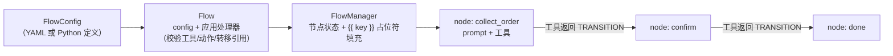
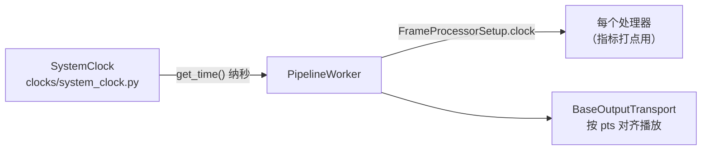

# 16 · Flows 与支撑模块：结构化对话、分类器、时钟

[← 上一章：音频子系统](15-audio-subsystem.md) | [Wiki 首页](README.md)

> **本页要点**
>
> - **Pipecat Flows**（`src/pipecat/flows/`）：预定义/动态对话路径引擎——节点 = 函数调用，返回值决定流转；支持 YAML 与 Python 两种配置
> - **Classifiers**（`src/pipecat/classifiers/`）：对任意状态提「类型化问题」（是/否、选择、评分）的对象，不进管道、不流帧
> - **Clocks**（`src/pipecat/clocks/`）：管道时钟抽象（默认 `SystemClock`），驱动输出传输的 pts 对齐与打点

## 16.1 Pipecat Flows：结构化对话引擎

自由对话（agent 决定说什么）之外，很多业务需要**预定义路径**：订餐流程、客服工单、问卷访谈。Flows 把「对话状态机」做成一等公民。

### 16.1.1 核心概念



- **`FlowConfig`**：声明节点（prompt、要注册的工具、转移、动作）。
- **`Flow`**（`flows/flow.py`）：「config joined to the application's handlers」——把配置里的节点变成可运行结构：每个工具引用解析成 Flows 直接函数、每个转移接到对应节点；构造时做静态校验（工具存在、签名合法、动作可调用）。
- **`FlowManager`**（`flows/manager.py:88`）：运行时状态机——进入节点时用状态填充 prompt 里的 `{{ key }}` 占位符，跟踪当前节点与上下文策略（`ContextStrategyConfig`）。
- **转移机制**：节点工具的返回值是 `(result, TRANSITION_IN_YAML)` 形态，由配置决定下一个节点；`transition_only` 函数可以只做流转不产生回复。
- **`NO_RESPONSE`**（`flows/types.py`）：某个结果不触发 bot 说话。
- 支撑：`actions.py`（节点动作：切换 LLM、TTS 说话等）、`adapters.py`（不同 LLM 服务的函数注册适配）、`exceptions.py`（`FlowError`/`FlowReferenceError`）。

### 16.1.2 两种写法与示例

`examples/flows/` 下分 `python/`（代码定义节点）与 `yaml/`（YAML 配置驱动，非程序员也能改流程）两套。典型形态：

```yaml
# yaml 流程（示意）
node: collect_order
prompt: "询问用户要订什么，{{order_size}}"
functions:
  collect_order:
    transition: confirm_order
    function:
      type: function
      # 函数 schema + handler
```

适用判断：**流程可预测**用 Flows；**流程开放**（闲聊、任意问答）用普通管道 + 系统提示词。两者可混用（某个节点里嵌函数调用自由对话）。

## 16.2 Classifiers：对状态提类型化问题

```python
# classifiers/base_classifier.py（docstring 节选）
# A classifier is a plain object. Whoever needs answers creates one, keeps it,
# and calls it. It does not sit in a pipeline and no frames flow into it.
# A question is one of YesNoQuestion, ChoiceQuestion or ScoreQuestion.
```

**设计哲学与管道服务相反**：分类器不进管道、不处理帧——它是应用代码直接持有的对象，按需调用、返回类型化结果。

### 16.2.1 问题与结果类型

| 问题类型 | 返回 | 用途示例 |
| ---- | ---- | ---- |
| `YesNoQuestion`（`:44`） | `YesNoResult` | 「用户刚才这句话是在生气吗？」 |
| `ChoiceQuestion`（`:60`） | `ChoiceResult` | 「这段话属于哪个意图？（退货/换货/咨询）」 |
| `ScoreQuestion`（`:74`） | `ScoreResult` | 「给用户满意度打 1-5 分」 |
| `ClassifierImage`（`:93`） | — | 附带图像一起问（多模态分类） |

`ask()` 接受任意混合的问题（一次问多个），`yes_no()`/`choice()`/`score()` 问同类问题；失败抛 `ClassifierError`。

### 16.2.2 提供商

| 目录 | 说明 |
| ---- | ---- |
| `classifiers/openai/` | 用 OpenAI 模型做分类 |
| `classifiers/llm/` | 通用 LLM 分类器（任意兼容服务） |
| `classifiers/cloudflare/`、`classifiers/jev/`、`classifiers/typesafe/` | 托管分类端点（jev/typesafe 同时被评估框架的 judge 使用，见 [13](13-testing-evals.md)） |

**框架内部消费方**：轮次 stop 策略 `ClassifierUserTurnStopStrategy`（[07](07-turn-management.md)）——每次停顿问分类器「这句说完了吗」，且**失败/超时立即放行**，轮次永不卡在分类器上。示例：`examples/features/features-classifiers.py`。

## 16.3 Clocks：时间基准



- `BaseClock`（`clocks/base_clock.py`）抽象 `get_time()`（纳秒）；默认 `SystemClock`。
- 消费方：帧的 `pts` 时间戳、`FrameProcessed`/`FramePushed` 观察者数据的 `timestamp`、输出传输的时钟队列（`_clock_task_handler` 按 `pts` 与时钟比较延时播放，见 [08](08-transports-serializers.md)）。
- 需要自定义时间源（如视频流时钟）时可注入 `PipelineWorker(clock=...)`。

## 16.4 其它支撑模块速查

| 模块 | 一句话 |
| ---- | ---- |
| `src/pipecat/transcriptions/` | 转录数据模型（Transcription、Language 枚举等） |
| `src/pipecat/metrics/` | 指标数据模型（详见 [12](12-observers-metrics.md)） |
| `src/pipecat/utils/` | asyncio 任务管理（TaskManager）、BaseObject、脱敏、字符串助手、tracing 工具 |
| `src/pipecat/tests/` | 测试工具（`run_test()` 等，见 [13](13-testing-evals.md)） |
| `src/pipecat/cli/` | `pipecat` 命令行（`init` 脚手架、`eval` 评估） |
| `src/pipecat/serializers/`、`adapters/`、`expressive/` | 已在 [08](08-transports-serializers.md)、[09](09-services.md) 详述 |

## 16.5 小结

- **Flows 把「流程确定性」和「LLM 灵活性」缝合**：路径是配置的，每个节点内部仍是自由的 LLM + 工具调用；YAML 形态让非工程师也能改流程。
- **Classifiers 是「管道外的第二世界」**：不占帧流、按需调用、答案带类型——对话中途需要快速判定（意图、情绪、满意度）时用它，别硬塞进管道。
- 至此 16 章覆盖了 `src/pipecat/` 的全部主要目录——从帧到字节、从单管道到多 Worker、从自由对话到结构化流程。

[← 上一章：音频子系统](15-audio-subsystem.md) | [Wiki 首页](README.md)
