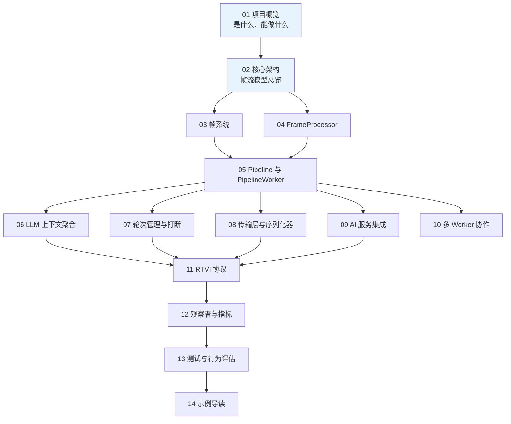

# Pipecat 深度 Wiki

> 本 Wiki 是对 **Pipecat v1.15.0** 源码的结构化解读，采用 DeepWiki（zread / Qoder Wiki）风格组织：按主题分章、由浅入深，配以架构图（Mermaid）、源码索引和速查表格，帮助你在最短时间内建立对框架的全局认知，再按需深入任意模块。

## 这是什么项目

**Pipecat** 是一个开源 Python 框架，用于构建**实时语音与多模态对话 AI 智能体**。它以「帧（Frame）驱动的管道」为核心模型，统一编排音频/视频流、60+ 家 AI 服务、各类传输协议（WebRTC / WebSocket / 电话）与对话逻辑 —— 从单个语音机器人到跨进程、跨机器的多智能体系统都可以用它搭建。

## 阅读路线



- **快速上手者**：01 → 02 → 14（示例导读），照着示例跑通一个 bot 即可。
- **二次开发者 / 集成者**：01 → 02 → 03 → 04 → 05，理解帧流模型后按需选读 08、09。
- **架构研究者**：全序阅读，重点关注 02、05、10。

## 目录

| 序号 | 文档 | 内容 | 关键源码位置 |
| ---- | ---- | ---- | ---- |
| 01 | [项目概览](01-project-overview.md) | 定位、应用场景、生态、仓库导览 | `README.md` |
| 02 | [核心架构](02-core-architecture.md) | 帧流模型、分层结构、一次对话的完整数据流 | `src/pipecat/` |
| 03 | [帧系统](03-frames.md) | Frame 继承体系、方向性、不可中断帧、系统帧 | `src/pipecat/frames/frames.py` |
| 04 | [FrameProcessor](04-frame-processor.md) | 处理器生命周期、`process_frame` 编写规则、任务与错误管理 | `src/pipecat/processors/frame_processor.py` |
| 05 | [Pipeline 与 PipelineWorker](05-pipeline-and-worker.md) | 管道编排、Worker 生命周期、`PipelineParams`、`WorkerRunner` | `src/pipecat/pipeline/`、`src/pipecat/workers/runner.py` |
| 06 | [LLM 上下文与聚合器](06-llm-context-aggregation.md) | `LLMContext`、`LLMContextAggregatorPair`、上下文持久化 | `src/pipecat/processors/aggregators/` |
| 07 | [轮次管理与打断](07-turn-management.md) | 用户开始/结束说话策略、静音策略、打断机制 | `src/pipecat/turns/` |
| 08 | [传输层与序列化器](08-transports-serializers.md) | Daily/LiveKit/WebSocket 等传输、电话序列化器 | `src/pipecat/transports/`、`src/pipecat/serializers/` |
| 09 | [AI 服务集成](09-services.md) | STT/TTS/LLM/Vision 服务基类、60+ 提供商、适配器 | `src/pipecat/services/`、`src/pipecat/adapters/` |
| 10 | [多 Worker 协作](10-multi-worker.md) | WorkerBus、Registry、Job RPC、LLM/UI Worker | `src/pipecat/bus/`、`src/pipecat/workers/` |
| 11 | [RTVI 协议](11-rtvi.md) | 客户端↔管道实时语音接口协议 | `src/pipecat/processors/frameworks/rtvi/` |
| 12 | [观察者与指标](12-observers-metrics.md) | Observer 模型、内置观察者、指标与追踪 | `src/pipecat/observers/`、`src/pipecat/metrics/` |
| 13 | [测试与行为评估](13-testing-evals.md) | 单元测试、行为评估（scripted / simulation）、发布套件 | `tests/`、`src/pipecat/evals/`、`evals/` |
| 14 | [示例导读](14-examples-guide.md) | 25+ 示例目录导览、最小 bot 解析、开发运行器 | `examples/` |
| 15 | [音频子系统](15-audio-subsystem.md) | VAD 分析器、降噪过滤器、混音器、重采样器、SmartTurn 轮次检测、DTMF | `src/pipecat/audio/` |
| 16 | [Flows 与支撑模块](16-flows-and-support.md) | Pipecat Flows 结构化对话、Classifiers、时钟 | `src/pipecat/flows/`、`src/pipecat/classifiers/`、`src/pipecat/clocks/` |

## 约定

- 源码引用统一写作 `` `src/pipecat/xxx.py:行号` `` 或目录形式，指向仓库内真实路径。
- 架构图使用 Mermaid 语法，GitHub / GitLab / VS Code 均可直接渲染。
- 术语保留英文原名（如 `FrameProcessor`、`StartFrame`），首次出现时给出中文解释。
- 本 Wiki 基于 v1.15.0 源码编写；1.3.0 起框架以 **Worker** 模型取代了旧的 `PipelineTask`，文中遇到废弃 API 会明确标注。

## 浏览方式

| 方式 | 说明 |
| ---- | ---- |
| **本地网页版（推荐）** | 直接双击打开本目录的 `index.html`——单文件站点，左侧章节目录 + 渲染后的架构图，效果对齐 zread；重新生成：`node docs/wiki/build_site.mjs` |
| GitHub / VS Code | 直接阅读各 `.md`，Mermaid 图原生渲染 |
| zread.ai | zread 按「GitHub 仓库地址」生成它自己的 Wiki（不支持直接导入本地 md）。想在该平台查看：把本仓库（含 `docs/wiki/`）推到 GitHub 后，在 zread.ai 输入仓库地址生成；本文档可作为人工深度版的补充 |

## 快速开始（30 秒版）

```bash
uv sync --group dev --all-extras --no-extra gstreamer --no-extra local
cp env.example .env   # 填入 DEEPGRAM_API_KEY / CARTESIA_API_KEY / OPENAI_API_KEY 等
python examples/getting-started/06-voice-agent.py --transport daily
```

一个完整语音 bot 的骨架只有约 30 行（见 [14 示例导读](14-examples-guide.md)），其背后的完整执行链路在 [02 核心架构](02-core-architecture.md) 中逐步拆解。
